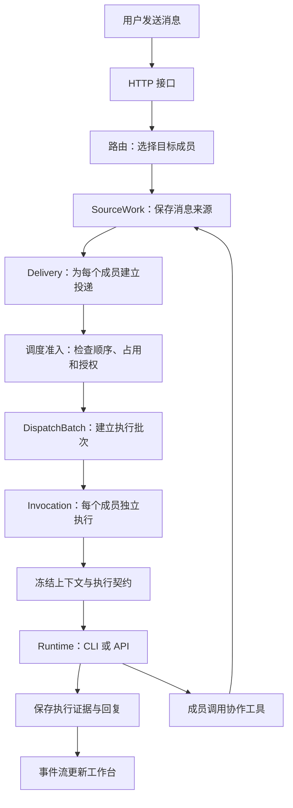
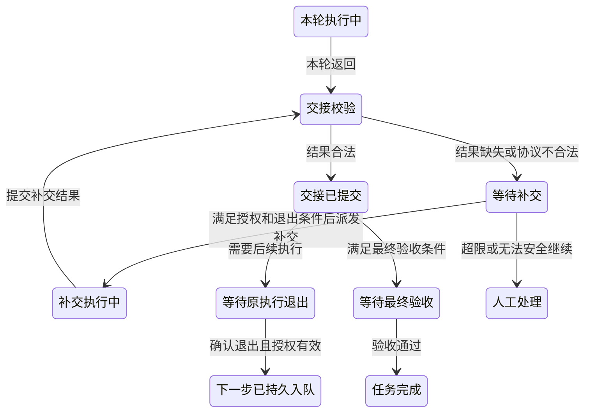
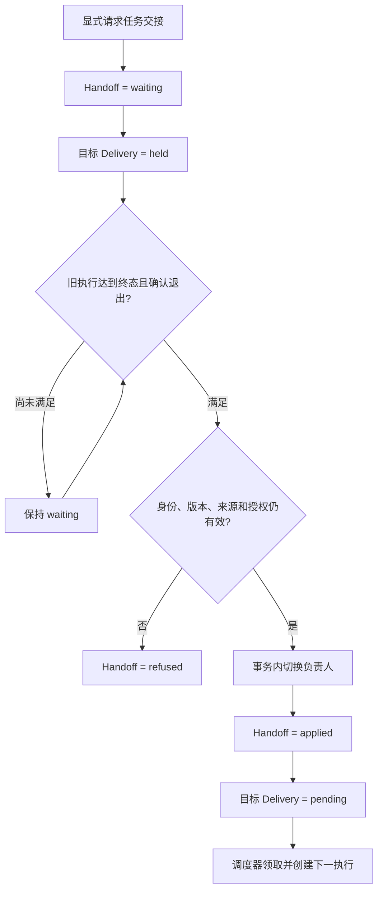
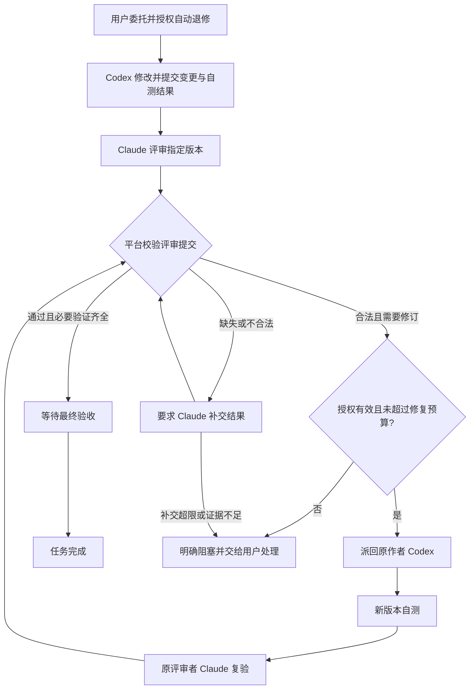
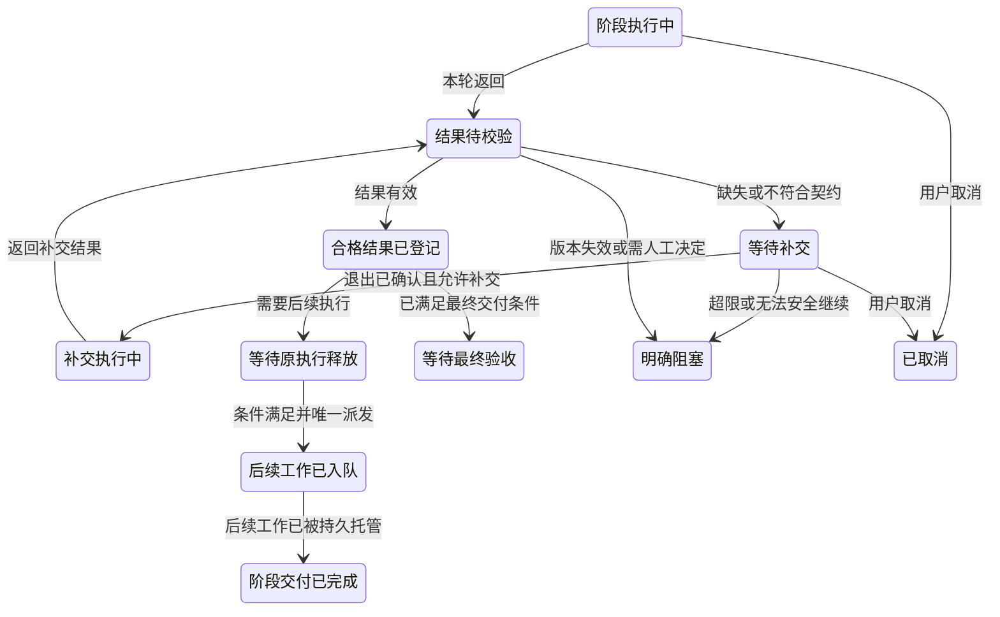
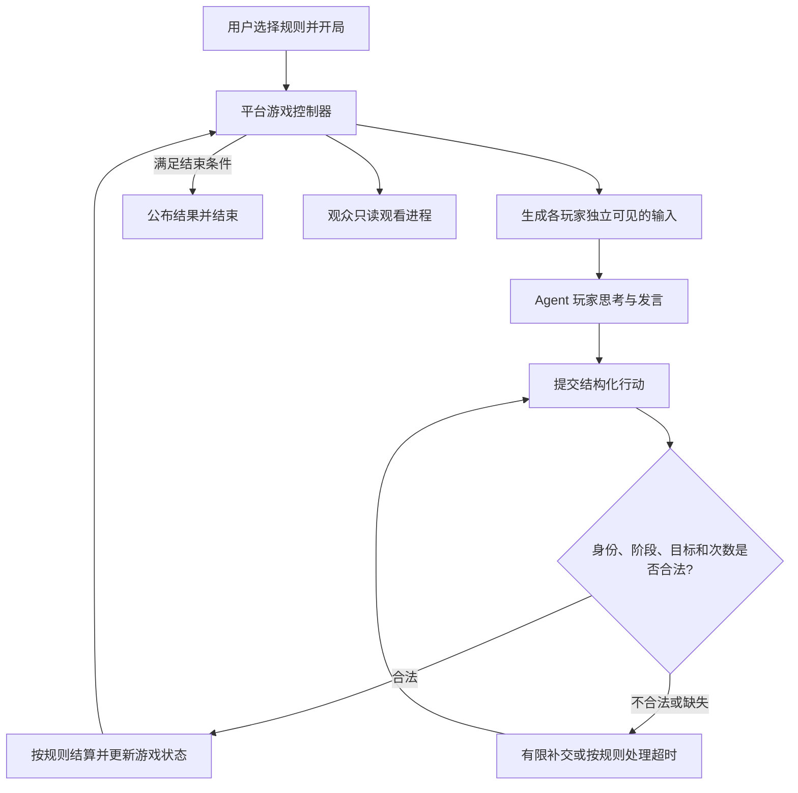
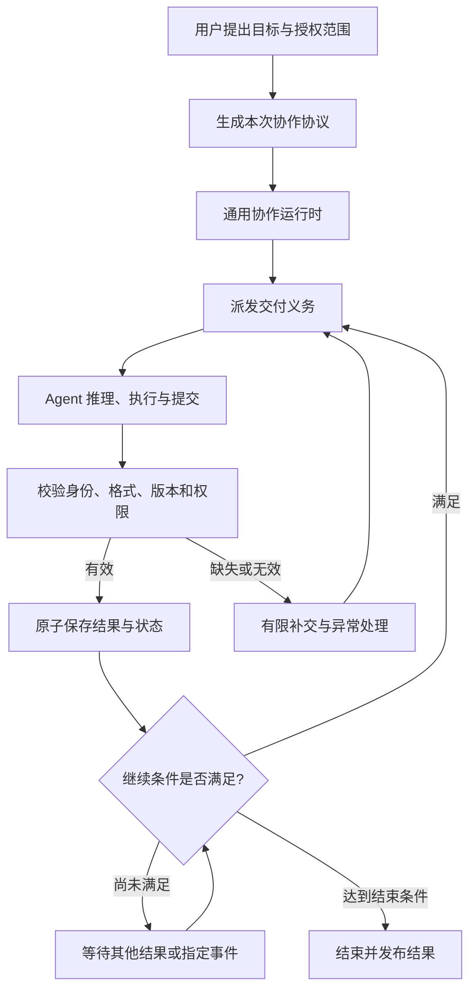
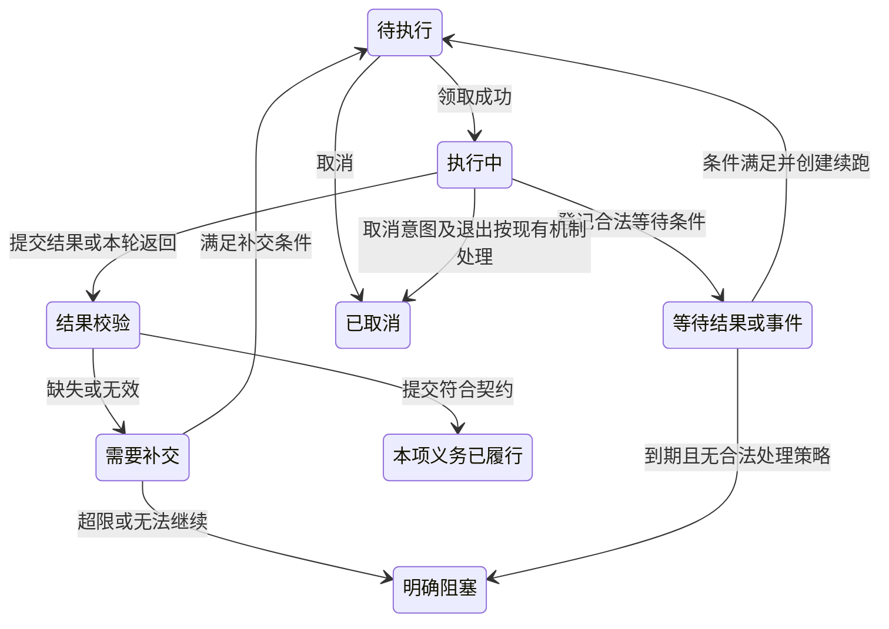
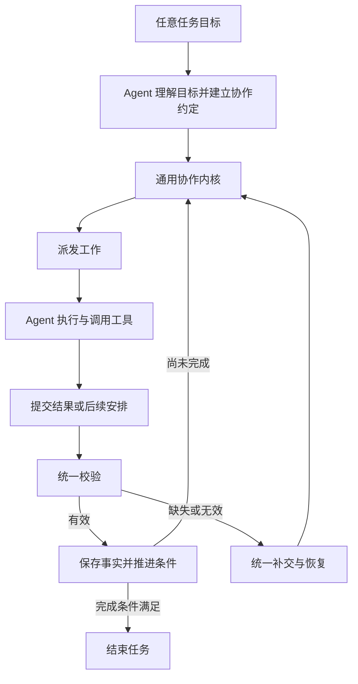
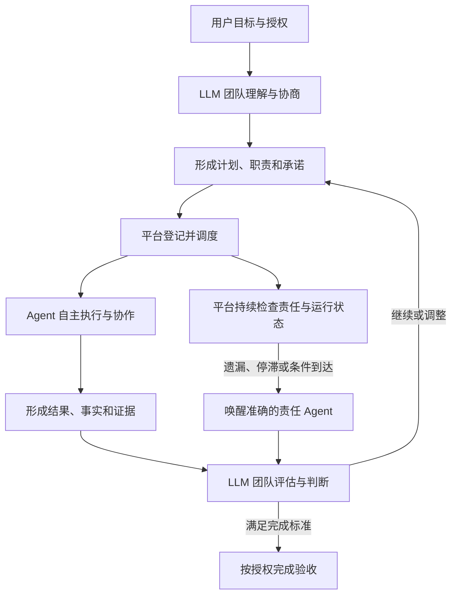

# 拉取项目：https://github.com/cat15926/Multi-Agent-collab.git ，然后…

> 拉取项目：[https://github.com/cat15926/Multi-Agent-collab.git](https://github.com/cat15926/Multi-Agent-collab.git) ，然后在本地启动

<details><summary>8 previous messages</summary>

> 我先检查本地目录和项目的启动说明，再拉取代码、安装依赖并启动服务。
>
> <details><summary>Ran 2 commands, called 2 tools</summary>
>
> - Ran `Get-Location; Get-ChildItem -Force; git status --short; git remote -v`
>
> MCP tool call
>
> node_repl.js
>
> ```json
> {
>   "code": "var fs = await import('node:fs/promises'); var cp = await import('node:child_process'); var util = await import('node:util'); var run = util.promisify(cp.execFile); var root = 'D:/project/Multi-agent'; console.log(await fs.readdir(root,{withFileTypes:true}).then(x=>x.map(y=>({name:y.name,dir:y.isDirectory()})))); console.log(await run('git',['--version'],{cwd:root}));",
>   "title": "检查工作目录和 Git"
> }
> ```
>
> Error: trusted Node process exited unexpectedly; kernel reset, rerun your request
>
> - Ran `Get-ChildItem -Force`
>
> MCP tool call
>
> node_repl.js
>
> ```json
> {
>   "code": "console.log(nodeRepl.cwd); var fs = await import('node:fs/promises'); console.log(await fs.readdir('D:/project/Multi-agent'));",
>   "title": "读取本地项目目录"
> }
> ```
>
> Error: node_repl kernel exited unexpectedly
>
> node_repl diagnostics: {"kernel_pid":32488,"kernel_status":"exited(code=1)","kernel_stderr_tail":"windows sandbox failed: CreateProcessWithLogonW failed: 1385","reason":"stdout_eof","stream_error":null}
>
> </details>
>
> 当前执行环境在创建进程时遇到 Windows 登录权限错误（1385）。我会尝试备用执行方式，继续检查目录并拉取项目。
>
> <details><summary>Ran 7 commands</summary>
>
> - Ran `Get-ChildItem -Force; git status --short; git remote -v`
> - Ran `git clone https://github.com/cat15926/Multi-Agent-collab.git .`
> - Ran `Get-ItemProperty -LiteralPath 'HKCU:\Software\Microsoft\Windows\CurrentVersion\Internet Settings' -Name ProxyEnable,ProxyServer -ErrorAction SilentlyContinue | Select-Object ProxyEnable,ProxyServer; Get-Command git,node,npm,python,py,docker -ErrorAction SilentlyContinue | Select-Object Name,Source; Get-ChildItem -Force`
> - Ran `git -c http.version=HTTP/1.1 clone https://github.com/cat15926/Multi-Agent-collab.git .`
> - Ran `git -c http.proxy=http://127.0.0.1:7897 clone https://github.com/cat15926/Multi-Agent-collab.git .`
> - Ran `Get-ChildItem -Force | Format-Table Name,Mode; rg --files -g AGENTS.md -g README* -g '*lock*' -g 'package.json' -g 'pyproject.toml' -g 'requirements*.txt' -g '*compose*' -g '.env*' -g '*.example' -g '*.sample'; Get-Command git,node,npm,python,py,docker -ErrorAction SilentlyContinue | Format-Table Name,Source; git status --short; git log -1 --format='%h %s'`
> - Ran `Get-Content -LiteralPath AGENTS.md; Get-Content -LiteralPath README.md; Get-Content -LiteralPath package.json; Get-Content -LiteralPath .env.example; Get-Content -LiteralPath .nvmrc; Get-ChildItem -LiteralPath 'C:\Users\lihengzhong\.cache\codex-runtimes\codex-primary-runtime\dependencies\node\bin' | Select-Object -ExpandProperty Name; Get-ChildItem -Path D:\project -Filter AGENTS.md -Force; Get-Item -LiteralPath D:\AGENTS.md -ErrorAction SilentlyContinue`
>
> </details>
>
> 代码已通过系统代理拉取到 `D:\project\Multi-agent`。项目要求 Node.js 24，默认地址是 `http://127.0.0.1:4310`；接下来检查运行环境、安装依赖并构建。
>
> <details><summary>Ran 6 commands</summary>
>
> - Ran `Get-Content -LiteralPath docs/implementation-progress.md -TotalCount 65; Get-Content -LiteralPath docs/implementation-guide.md -TotalCount 70; node --version; where.exe npm; Get-ChildItem -LiteralPath 'C:\Users\lihengzhong\.cache\codex-runtimes\codex-primary-runtime\dependencies' | Format-Table Name,Mode; Get-ChildItem -LiteralPath 'C:\Program Files\nodejs' -ErrorAction SilentlyContinue | Select-Object -ExpandProperty Name; rg -n 'listen\(|health|APP_PORT|process.platform|chmod|symlink' server/index.ts scripts/platform-local.py scripts/copy-runtime-assets.mjs .gitignore`
> - Ran `Get-Content -LiteralPath .gitignore; Get-Content -LiteralPath scripts/copy-runtime-assets.mjs; Get-Content -LiteralPath scripts/platform-local.py -TotalCount 120; Get-ChildItem -LiteralPath 'C:\Users\lihengzhong\.cache\codex-runtimes\codex-primary-runtime\dependencies\node' | Format-Table Name,Mode; Get-ChildItem -LiteralPath 'C:\Users\lihengzhong\AppData\Roaming\npm','C:\Users\lihengzhong\AppData\Local\Programs\nodejs','D:\tool' -ErrorAction SilentlyContinue | Format-Table FullName; Get-NetTCPConnection -LocalPort 4310 -State Listen -ErrorAction SilentlyContinue | Format-Table LocalAddress,LocalPort,OwningProcess; Get-Content -LiteralPath server/index.ts -TotalCount 95; Get-Content -LiteralPath server/index.ts -Tail 40`
> - Ran `Get-ChildItem -LiteralPath 'C:\Users\lihengzhong\.cache\codex-runtimes\codex-primary-runtime\dependencies\node\node_modules' | Select-Object -ExpandProperty Name; Get-ChildItem -LiteralPath 'C:\Users\lihengzhong\.cache\codex-runtimes\codex-primary-runtime\dependencies\bin' | Select-Object -ExpandProperty Name; where.exe curl.exe; rg -n 'engines|"node"|resolved' package-lock.json | Select-Object -First 12`
> - Ran `New-Item -ItemType Directory -Path .local-data/tools -Force | Out-Null; curl.exe --fail --location --proxy http://127.0.0.1:7897 --connect-timeout 15 --max-time 60 https://registry.npmjs.org/npm/-/npm-11.6.2.tgz --output .local-data/tools/npm-11.6.2.tgz; if ($LASTEXITCODE -ne 0) { exit $LASTEXITCODE }; tar.exe -xzf .local-data/tools/npm-11.6.2.tgz -C .local-data/tools; if ($LASTEXITCODE -ne 0) { exit $LASTEXITCODE }; node .local-data/tools/package/bin/npm-cli.js --version; node .local-data/tools/package/bin/npm-cli.js ci --cache .local-data/npm-cache --proxy=http://127.0.0.1:7897 --https-proxy=http://127.0.0.1:7897 --no-audit --no-fund`
> - Ran `$env:Path = (Join-Path $PWD '.local-data\tools\package\bin') + ';' + $env:Path; node .local-data/tools/package/bin/npm-cli.js run build`
> - Ran `New-Item -ItemType Directory -Path .local-data/tools/bin -Force | Out-Null; Set-Content -LiteralPath .local-data/tools/bin/npm.cmd -Encoding ascii -Value '@node "%~dp0..\package\bin\npm-cli.js" %*'; $env:Path = (Join-Path $PWD '.local-data\tools\bin') + ';' + $env:Path; node .local-data/tools/package/bin/npm-cli.js run build`
>
> </details>
>
> 依赖安装和前后端构建已完成。我现在将服务放到后台运行，并检查健康接口、工作台页面和静态资源。
>
> <details><summary>Ran 2 commands</summary>
>
> - Ran `if (-not (Test-Path -LiteralPath .env)) { Copy-Item -LiteralPath .env.example -Destination .env }; $nodePath = (Get-Command node.exe).Source; $platformProcess = Start-Process -FilePath $nodePath -ArgumentList '--env-file-if-exists=.env','dist/server/index.js' -WorkingDirectory 'D:\project\Multi-agent' -RedirectStandardOutput 'D:\project\Multi-agent\.local-data\server.log' -RedirectStandardError 'D:\project\Multi-agent\.local-data\server-error.log' -WindowStyle Hidden -PassThru; [pscustomobject]@{ pid=$platformProcess.Id; port=4310; url='http://127.0.0.1:4310'; node=$nodePath; entry='D:\project\Multi-agent\dist\server\index.js'; startedAt=(Get-Date).ToString('o') } | ConvertTo-Json | Set-Content -LiteralPath .local-data/windows-process.json -Encoding utf8; Start-Sleep -Seconds 2; Get-Content -LiteralPath .local-data/windows-process.json; Get-Content -LiteralPath .local-data/server.log; Get-Content -LiteralPath .local-data/server-error.log; Invoke-RestMethod -Uri http://127.0.0.1:4310/health -TimeoutSec 10 | ConvertTo-Json; $workbenchPage = Invoke-WebRequest -Uri http://127.0.0.1:4310/ -TimeoutSec 10; [pscustomobject]@{status=$workbenchPage.StatusCode; type=$workbenchPage.Headers.'Content-Type'; html=$workbenchPage.Content} | ConvertTo-Json`
> - Ran `rg -n 'bootstrap|accounts|runtime' server/collaboration/http.ts | Select-Object -First 14; $workbenchPage = Invoke-WebRequest -Uri http://127.0.0.1:4310/ -TimeoutSec 10; $assetPaths = [regex]::Matches($workbenchPage.Content, '(?:src|href)="(/assets/[^"]+)"') | ForEach-Object { $_.Groups[1].Value }; foreach ($assetPath in $assetPaths) { $assetResult = Invoke-WebRequest -Uri ('http://127.0.0.1:4310' + $assetPath) -TimeoutSec 10; [pscustomobject]@{path=$assetPath;status=$assetResult.StatusCode;bytes=$assetResult.RawContentLength} | ConvertTo-Json -Compress }; $bootstrap = Invoke-RestMethod -Uri http://127.0.0.1:4310/api/collaboration/bootstrap -TimeoutSec 10; [pscustomobject]@{bootstrapFields=($bootstrap.PSObject.Properties.Name -join ', ');version=$bootstrap.version} | ConvertTo-Json; Get-NetTCPConnection -LocalPort 4310 -State Listen | Format-Table LocalAddress,LocalPort,OwningProcess; git status --short`
>
> </details>
</details>

已拉取并在后台启动，依赖安装和构建均成功。

- 访问：[本地协作工作台](http://127.0.0.1:4310)
- 项目目录：`D:\project\Multi-agent`
- 版本：`0.25.0-p8-pr-ci`
- 健康检查、初始化接口和页面资源均正常。

实际调用模型前，请在「成员与运行时」配置 CLI 登录或 API 账户。

> 更新代码

<details><summary>3 previous messages</summary>

> Stream error
>
> Reconnecting 5/5
> stream disconnected before completion: 由于目标计算机积极拒绝，无法连接。 (os error 10061)
>
> 我先检查本地改动和远端更新，再拉取代码；如果有新版本，会保留运行数据、重新构建并重启本地服务。
>
> <details><summary>Ran 4 commands</summary>
>
> - Ran `git status --short; git branch --show-current; git remote -v; git log -1 --format='%h %s'; Get-Content -LiteralPath docs/implementation-progress.md -TotalCount 22; Get-Content -LiteralPath docs/implementation-guide.md -TotalCount 22; Get-Content -LiteralPath .local-data/windows-process.json -ErrorAction SilentlyContinue; try { Invoke-RestMethod -Uri http://127.0.0.1:4310/health -TimeoutSec 5 | ConvertTo-Json } catch { Write-Output $_.Exception.Message }`
> - Ran `git status --short; git branch --show-current; git remote -v; git log -1 --format='%h %s'; Get-Content -LiteralPath docs/implementation-progress.md -TotalCount 22; Get-Content -LiteralPath docs/implementation-guide.md -TotalCount 22; Get-Content -LiteralPath .local-data/windows-process.json -ErrorAction SilentlyContinue; try { Invoke-RestMethod -Uri http://127.0.0.1:4310/health -TimeoutSec 5 | ConvertTo-Json } catch { Write-Output $_.Exception.Message }`
> - Ran `git -c http.proxy=http://127.0.0.1:7897 fetch origin; if ($LASTEXITCODE -ne 0) { exit $LASTEXITCODE }; git rev-list --left-right --count HEAD...origin/main; git log --oneline HEAD..origin/main; git diff --stat HEAD..origin/main; git diff HEAD..origin/main -- package.json AGENTS.md .env.example; Get-Content -LiteralPath .env | Where-Object { $_ -match '^APP_(PORT|DATA_DIR|WORKSPACE)=' }; Get-CimInstance Win32_Process -Filter "ProcessId = 34184" | Select-Object ProcessId,ExecutablePath,CommandLine | ConvertTo-Json; rg -n 'CREATE TABLE|status.*running|in_flight|active|lease|invocations|deliveries' server/collaboration/store.ts server/store.ts | Select-Object -First 50`
> - Ran `git -c http.proxy=http://127.0.0.1:7897 pull --ff-only origin main; if ($LASTEXITCODE -ne 0) { exit $LASTEXITCODE }; git status --short; git log -1 --format='%h %s'; $bootstrap = Invoke-RestMethod -Uri http://127.0.0.1:4310/api/collaboration/bootstrap -TimeoutSec 10; [pscustomobject]@{version=$bootstrap.version;health=(Invoke-RestMethod -Uri http://127.0.0.1:4310/health -TimeoutSec 5)} | ConvertTo-Json`
>
> </details>
</details>

已执行拉取，`main` 已是远端最新代码，当前提交为 `fe1486e`，无需重新构建或重启。

[本地工作台](http://127.0.0.1:4310)运行正常，版本为 `0.25.0-p8-pr-ci`。

> 我正在调研这个项目目前多agent协作调度的实现情况，基于源码，帮我分析这个项目有哪些模块，分别负责哪些功能。

<details><summary>5 previous messages</summary>

> 我会先读正式进度和实施指导，再沿着消息路由、调度、执行与结果回写的源码梳理模块，标出各自职责、调用关系和当前实现边界。
>
> <details><summary>Ran 5 commands</summary>
>
> - Ran `Get-Content -LiteralPath docs/implementation-progress.md; Get-Content -LiteralPath docs/implementation-guide.md; rg --files server shared web tests; Get-Content -LiteralPath package.json`
> - Ran `git rev-parse --short HEAD; rg -n '^(export )?(class|function|interface|type)|^  (async )?[a-zA-Z][a-zA-Z0-9_]*\(' server/collaboration/engine.ts server/collaboration/store.ts server/collaboration/routing.ts server/collaboration/context.ts server/collaboration/cooperation.ts server/collaboration/runtime.ts; Get-Content -LiteralPath server/collaboration/engine.ts -TotalCount 245`
> - Ran `Get-Content -LiteralPath server/collaboration/routing.ts; Get-Content -LiteralPath server/collaboration/store.ts | Select-Object -Skip 376 -First 64; Get-Content -LiteralPath server/collaboration/store.ts | Select-Object -Skip 499 -First 81; Get-Content -LiteralPath server/collaboration/store.ts | Select-Object -Skip 668 -First 150; Get-Content -LiteralPath server/collaboration/context.ts -TotalCount 180`
> - Ran `$source = Get-Content -LiteralPath server/collaboration/store.ts; for ($line=545; $line -le 579; $line++) { '{0}: {1}' -f $line,$source[$line-1] }; for ($line=695; $line -le 817; $line++) { '{0}: {1}' -f $line,$source[$line-1] }`
> - Ran `Get-Content -LiteralPath server/collaboration/runtime.ts; rg -n '^export (interface|type|const)|^  (start|invoke|probe|inspect|sessionIdentity)|^export (async )?function' shared/collaboration.ts server/collaboration/runtime-*.ts server/collaboration/continuity.ts; Get-Content -LiteralPath server/store.ts -TotalCount 95`
>
> </details>
>
> 源码显示，核心采用“来源消息 → 成员投递 → 批次 → 独立执行”的持久调度方式。路由只决定交给谁；是否能执行，还要检查成员占用、前序来源、授权和上一次执行的退出证据。我会继续核对任务交接、多人征询、跨会话协作和运行时之间的边界。
>
> <details><summary>Ran 6 commands</summary>
>
> - Ran `$source = Get-Content -LiteralPath server/collaboration/cooperation.ts; for ($line=1; $line -le 140; $line++) { '{0}: {1}' -f $line,$source[$line-1] }; for ($line=144; $line -le 177; $line++) { '{0}: {1}' -f $line,$source[$line-1] }; for ($line=195; $line -le 265; $line++) { '{0}: {1}' -f $line,$source[$line-1] }`
> - Ran `rg -n '^(export )?(class|interface|type|function|const)|^  (async )?[a-zA-Z][a-zA-Z0-9_]*\(' server/collaboration/tasks.ts server/collaboration/actions.ts server/collaboration/cross.ts server/collaboration/artifacts.ts server/collaboration/memory.ts server/collaboration/visibility.ts; Get-Content -LiteralPath server/collaboration/tasks.ts | Select-Object -Skip 110 -First 115; Get-Content -LiteralPath server/collaboration/actions.ts | Select-Object -Skip 1 -First 48`
> - Ran `$source = Get-Content -LiteralPath server/collaboration/runtime.ts; for ($line=1; $line -le 72; $line++) { '{0}: {1}' -f $line,$source[$line-1] }; for ($line=155; $line -le $source.Count; $line++) { '{0}: {1}' -f $line,$source[$line-1] }; Get-Content -LiteralPath shared/collaboration.ts -TotalCount 18; rg -n 'export (async )?function|export class|export const .*TOOLS|toolDefinitions|COLLABORATION_TOOLS' server/collaboration -g 'runtime*.ts' -g '*tools.ts' -g 'continuity.ts'; rg -n 'sessionFingerprint|compatible|fingerprint|settleSession|resume|prepareSession|teardown|acceptance' server/collaboration/store.ts | Select-Object -Last 28`
> - Ran `rg -n '^export (class|function|async function)|^  (async )?[a-zA-Z][a-zA-Z0-9_]*\(' server/collaboration/workbench.ts server/collaboration/project-intents.ts server/collaboration/project-review.ts server/collaboration/project-revisions.ts server/collaboration/project-pulls.ts server/collaboration/inspection.ts server/collaboration/history-import.ts | Select-Object -First 95; rg -n 'events|route-preview|messages|send\(|project|cancel|recover|recheck|reorder|priority|multi-mention|input-handoffs' server/collaboration/http.ts | Select-Object -First 60; rg -n 'createApplication|CollaborationStore|CollaborationEngine|createCollaborationRuntime|heartbeat|collaborationRoutes|collaborationEngine|new Worker' server/index.ts; rg -n 'EventSource|/api/|legacy|CollaborationApp|WorkspacePanel|CooperationPanel|WorkbenchPanel' web/main.tsx web/CollaborationApp.tsx web/CooperationPanel.tsx web/WorkspacePanel.tsx | Select-Object -First 65`
> - Ran `rg -n '^test\(|^it\(' tests/collaboration-kernel.test.ts tests/collaboration-cooperation.test.ts tests/collaboration-inputs.test.ts tests/collaboration-recovery.test.ts tests/collaboration-tasks.test.ts tests/collaboration-actions.test.ts | Select-Object -First 75; Get-Content -LiteralPath server/collaboration/inspection.ts -TotalCount 125; Get-Content -LiteralPath server/collaboration/memory.ts | Select-Object -Skip 132 -First 45; Get-Content -LiteralPath server/collaboration/store.ts | Select-Object -Skip 35 -First 30; Get-Content -LiteralPath shared/collaboration.ts | Select-Object -Skip 112 -First 79`
> - Ran `rg -n 'wait\(|condition|reconcile\(|signal\(|candidate\(|verdict\(|notify|timer|artifact|job' server/collaboration/actions.ts | Select-Object -Last 35; rg -n 'export (class|async function|function)|^  [a-zA-Z][a-zA-Z0-9_]*\(' server/collaboration/project-vm.ts server/collaboration/project-vm-mount.ts server/collaboration/project-preview.ts server/collaboration/interactions.ts server/collaboration/project-git.ts | Select-Object -First 55; Get-Content -LiteralPath server/collaboration/runtime-common.ts | Select-Object -Skip 25 -First 83; Get-Content -LiteralPath server/collaboration/store.ts | Select-Object -Skip 925 -First 51; Get-Content -LiteralPath server/collaboration/continuity.ts -TotalCount 28; Get-Content -LiteralPath tests/collaboration-kernel.test.ts | Select-Object -Skip 23 -First 64`
>
> </details>
>
> 已核对主要调度流程和对应测试用例。需要区分三种机制：普通 A2A 请求只新增协助工作；任务交接会在旧执行确认退出后转移负责人；Action 则管理明确的责任、候选结果和条件唤醒。另外，多人征询收齐后只是汇集各成员结果，不会自动再调用模型综合结论。
</details>

基于当前源码（提交 `fe1486e`，产品版本 `0.25.0`），这个项目采用的是 **单机、会话驱动、按消息来源持久调度的多 Agent 协作架构**。平台决定消息交给谁、何时执行、授予哪些工具；成员在执行中可以请求其他成员协助。

核心实现集中在 `server/collaboration/`。其中，**`store.ts` 负责调度规则与状态一致性，`engine.ts` 负责驱动实际执行，`runtime*.ts` 负责调用不同的 Agent 承载**。这是理解整个项目最重要的分工。

下面先看主链路：



**这里的调度单位是“来源及其成员投递”**。一条消息可以投递给多个成员，每个成员有自己的执行和回复；任务负责人、模型接受请求、进程退出、业务完成则分别记录。

从源码职责上，可以将核心拆成以下模块：

| 模块 | 主要源码 | 负责的功能 |
|---|---|---|
| 服务装配与接口 | [server/index.ts](/D:/project/Multi-agent/server/index.ts:54)、[collaboration/http.ts](/D:/project/Multi-agent/server/collaboration/http.ts:94) | 创建数据库、协作引擎和运行时；提供消息发送、成员配置、取消、恢复核查等 HTTP 接口；通过 SSE 输出业务事件。 |
| 共享领域模型 | [shared/collaboration.ts](/D:/project/Multi-agent/shared/collaboration.ts:135) | 定义成员、账户、会话、来源、投递、批次、执行、回复、消费回执、执行契约等对象，也是前后端和运行时之间的协议。 |
| 成员、账户与工作区配置 | [workbench.ts](/D:/project/Multi-agent/server/collaboration/workbench.ts:40) | 管理成员与账户、默认模型、附件、工作区授权及配置版本；将成员的默认配置解析成本轮实际使用的配置。成员职责、运行程序、模型和认证账户分别管理。 |
| 消息路由 | [routing.ts](/D:/project/Multi-agent/server/collaboration/routing.ts:42) | 根据显式 `@`、成员组、偏好成员、历史点名和最近成功回复者等规则选择目标；发送预览与实际入队复用同一解析器。 |
| 持久调度与状态内核 | [store.ts](/D:/project/Multi-agent/server/collaboration/store.ts:521) | 保存来源和投递，检查成员占用及来源顺序，原子领取工作，创建批次、执行、回复、消费关系和契约；处理 A2A、终态、失败回报、取消和恢复。 |
| 队列与连续协作控制 | [cooperation.ts](/D:/project/Multi-agent/server/collaboration/cooperation.ts:13) | 管理来源排序、优先级、撤回、暂缓和发送前退避；支持待办读取、多来源归并、执行中追加，以及多人征询。 |
| 执行驱动 | [engine.ts](/D:/project/Multi-agent/server/collaboration/engine.ts:26) | 每 500ms 及业务变化后推进调度；启动已领取执行，调用运行时，分发工具调用，记录证据和结果；用 `AbortController` 传递取消意图。 |
| 上下文与执行契约 | [context.ts](/D:/project/Multi-agent/server/collaboration/context.ts:51)、[store.ts](/D:/project/Multi-agent/server/collaboration/store.ts:933) | 冻结身份、账户元数据、成员目录、授权、历史截止点和输入正文；控制上下文预算，记录纳入或排除的材料及摘要，形成可追溯的 `InputManifest`。 |
| 运行时适配 | [runtime.ts](/D:/project/Multi-agent/server/collaboration/runtime.ts:43)、[runtime-common.ts](/D:/project/Multi-agent/server/collaboration/runtime-common.ts:74) | 统一能力探测、认证检查、工具范围和调用接口，再分派到 Codex、Claude Code、Hermes、OpenAI 兼容 API 或 Anthropic API 的适配器。 |
| 原生会话延续与执行核查 | [continuity.ts](/D:/project/Multi-agent/server/collaboration/continuity.ts:6)、[inspection.ts](/D:/project/Multi-agent/server/collaboration/inspection.ts:40) | 根据模型、账户、职责、工作区、权限和 CLI 身份等指纹决定新建或续接；保存准确执行观察，供中断、取消和失联后的核查使用。 |

其中几个数据对象很容易混淆，源码对它们做了明确区分：

| 对象 | 表示什么 |
|---|---|
| `SourceWork` | 一份需要处理的输入，例如用户消息、A2A 请求或条件唤醒。 |
| `Delivery` | 这份输入对某个成员的投递责任，状态包括待投递、已承接、挂起和撤回。 |
| `DispatchBatch` | 本次共同领取的目标集合，记录串行/并行模式和统一历史截止点。 |
| `Invocation` | 某个成员的一次准确执行，记录运行状态、接受证据、原生会话及退出证据。 |
| `Response` | 该执行的输出，以及它承接了哪些来源。 |
| `Consumption` | 将准确来源、成员投递和回复关联起来的回执，区分通过初始输入、工具读取还是活动追加承接。 |

这意味着 **投递进入 `consumed` 只证明有准确回复负责承接，不证明模型已经接受，更不证明工作完成**。创建批次时，执行还可能处于 `prepared`，接受状态仍为 `unknown`。[创建与绑定逻辑](/D:/project/Multi-agent/server/collaboration/store.ts:554)

协作业务在这套内核上又扩展了以下模块：

| 模块 | 主要源码 | 职责及与调度的关系 |
|---|---|---|
| 普通任务与负责人交接 | [tasks.ts](/D:/project/Multi-agent/server/collaboration/tasks.ts:118) | 管理 `todo/doing/blocked/done`、负责人和责任版本。正式交接先创建等待记录，旧执行达到终态且确认退出后，才原子切换负责人并释放新投递。 |
| 产物、审批与评审 | [artifacts.ts](/D:/project/Multi-agent/server/collaboration/artifacts.ts:65) | 管理不可变产物版本、用户审批、受管写入作业、文件回执和固定版本评审。审批通过、文件发布、评审通过分别记录。 |
| 用户提问与权限交互 | [interactions.ts](/D:/project/Multi-agent/server/collaboration/interactions.ts:32) | 将用户问题、文件或命令授权请求绑定到准确执行；处理允许、拒绝、超时、取消和迟到答复。原生文件、命令还由专门的 approval 模块校验。 |
| 跨会话消息 | [cross.ts](/D:/project/Multi-agent/server/collaboration/cross.ts:65) | 管理准确的会话与成员端点授权、有效期、公开引用和跨会话投递；撤权或工作区身份变化后重新核验。 |
| 专用责任与条件唤醒 | [actions.ts](/D:/project/Multi-agent/server/collaboration/actions.ts:10) | 管理 Action 的负责人、当前执行者、代次、候选结果、接受或退回；支持定时、命名信号、受管作业成功和产物发布四类等待条件。 |
| 可见性与长期记忆 | [visibility.ts](/D:/project/Multi-agent/server/collaboration/visibility.ts:15)、[memory.ts](/D:/project/Multi-agent/server/collaboration/memory.ts:12) | 控制公开/私聊、选段分享、历史分支及工具可用范围；管理记忆提议、批准、实际收录与撤销，并在当前权限范围内检索材料。 |
| 本地历史导入 | [history-import.ts](/D:/project/Multi-agent/server/collaboration/history-import.ts:33) | 发现并核验既有 CLI 会话，预览、选择历史范围，再建立有来源记录的新会话；与平台管理的原生续接是不同入口。 |
| 项目执行与隔离 | [project-vm.ts](/D:/project/Multi-agent/server/collaboration/project-vm.ts:97)、[project-vm-mount.ts](/D:/project/Multi-agent/server/collaboration/project-vm-mount.ts:175) | 登记 Linux 项目执行器、绑定授权目录、获取执行资源、启动 CLI，并核对执行域退出；`project-official*` 等文件桥接官方登录与项目工具。 |
| 项目评审、退修与交付 | [project-review.ts](/D:/project/Multi-agent/server/collaboration/project-review.ts:21)、[project-revisions.ts](/D:/project/Multi-agent/server/collaboration/project-revisions.ts:29)、[project-pulls.ts](/D:/project/Multi-agent/server/collaboration/project-pulls.ts:34) | 在独立副本读取文件、准备依赖和运行检查；将失败交回原作者，再派原评审者复验。配套 Git 模块处理差异与确认推送，PR 监控按提交跟踪 CI，并在授权范围内触发退修。 |

此外，`project-research.ts`、`mcp-reader.ts`、`project-preview.ts`、`project-exports.ts` 分别提供公开网页查证、只读 MCP 查询、项目静态预览和项目外导出。它们是执行工具与交付能力，复用上述身份、授权和审计机制。

对于你重点关注的“协作调度”，源码中有六个值得关注的实现细节。

1. **路由和调度分开。**
   路由是确定性规则，核心顺序是显式点名，再按特定偏好模式、历史点名、最近成功回复者、偏好或默认成员等规则回退。成员正在忙不会导致消息自动改派给别人；忙闲由后续调度处理。[路由实现](/D:/project/Multi-agent/server/collaboration/routing.ts:42)

2. **同一来源按目标成组等待，独立成员可以继续工作。**
   例如 A 正在执行，后面依次有“交给 A+B”“交给 B”“交给 C”：A+B 会等待，B 的后续来源也不能越过前面的重叠工作，C 则可以执行。存在授权或配置原因形成的 `held` 投递时，还有单独的部分领取规则。占用判断针对会话中的成员；项目写入另外受项目目录及执行器资源约束。[准入逻辑](/D:/project/Multi-agent/server/collaboration/store.ts:502)、[对应测试](/D:/project/Multi-agent/tests/collaboration-kernel.test.ts:33)

3. **A2A 是新增持久工作。**
   成员调用 `collaboration_request` 后，平台核对实际调用者，创建新的来源和成员投递。一次可请求 1–2 个其他成员，默认深度上限为 8，并限制单次执行的请求数量、阻止同内容向祖先成员往返。普通成功不会自动叫回请求者；有准确调用与消费证明的失败会产生失败回报来源。[A2A 实现](/D:/project/Multi-agent/server/collaboration/store.ts:695)、[失败回报](/D:/project/Multi-agent/server/collaboration/store.ts:747)

4. **并行讨论、任务交接和多人征询有不同语义。**
   多目标批次各自执行，并行批次回复中的文字 `@` 不再触发接力；串行批次允许符合条件的行首 `@` 创建后续来源。普通 A2A 不转移任务负责人。`multi_mention` 则创建独立征询组，收齐各成员结果后发布一条汇集消息，不自动唤回发起者，也不额外调用模型综合结论。[回复接力](/D:/project/Multi-agent/server/collaboration/store.ts:767)、[征询收集](/D:/project/Multi-agent/server/collaboration/cooperation.ts:144)

5. **后续输入可以排队、归并或追加。**
   合法待办可以在初始完整输入中归并，或通过 `conversation_read` 全文读取后承接；仅看到背景或目录不等于处理了来源。活动追加目前专门对接 Codex 的准确运行句柄，区分发送、接受、读取及结果未知；不支持的承载保留下一轮投递。[待办读取](/D:/project/Multi-agent/server/collaboration/cooperation.ts:107)、[活动追加](/D:/project/Multi-agent/server/collaboration/cooperation.ts:195)

6. **中断恢复优先保持准确性。**
   成员占用的释放同时检查执行终态和 `teardown === 'confirmed'`。服务重启后，尚未发送的准确 `prepared` 执行可以启动；已经开始但结果不明的执行保留中断状态，不自动重发。取消版本与输入版本检查用于阻止迟到结果覆盖用户决定。[占用判断](/D:/project/Multi-agent/server/collaboration/store.ts:501)、[取消与恢复](/D:/project/Multi-agent/server/collaboration/store.ts:785)

前端则主要承担操作和状态呈现：`CollaborationApp.tsx` 提供聊天与事件订阅，`CooperationPanel.tsx` 展示来源队列、追加记录和征询，其他面板承接任务、产物、Action、记忆及项目操作。**实际调度规则在后端执行**，前端通过命令和 SSE 与其交互。[前端事件入口](/D:/project/Multi-agent/web/CollaborationApp.tsx:390)

从架构取舍看，当前实现有几个明确特点：

- **持久状态和审计较细。** 来源、投递、消费、供应商接受、退出证据和任务完成分别建模，适合追踪协作责任及排查重复派工。
- **业务状态转换集中在 SQLite 事务中。** 模型和网络调用放在事务外；同一数据库依靠服务租约控制活动实例。当前形态是单机服务，尚未体现多节点调度架构。[数据库与租约](/D:/project/Multi-agent/server/store.ts:38)
- **协作主要由规则和成员工具调用推进。** 代码里有任务、交接、条件等待和专门的退修闭环；通用的自动任务分解、依赖 DAG、按成本或负载选择成员等能力，未在这条调度主链中看到。
- **部分能力仍有边界。** 多人征询的收集器在内存中，重启会标为丢失；记忆检索目前实现为词法匹配，semantic/hybrid 显式返回未接入。项目原生子代理、并行工作树及后台开发服务等仍列在后续交付范围。[征询恢复](/D:/project/Multi-agent/server/collaboration/cooperation.ts:163)、[检索实现](/D:/project/Multi-agent/server/collaboration/memory.ts:133)、[正式进度](/D:/project/Multi-agent/docs/implementation-progress.md:55)

如果继续深入调度算法，建议依次阅读 `shared/collaboration.ts` → `routing.ts` → `store.ts` 的 `send/admitNext/requestCollaboration/finishTransition` → `engine.ts` → `cooperation.ts`。对应的核心场景集中在 [collaboration-kernel.test.ts](/D:/project/Multi-agent/tests/collaboration-kernel.test.ts:24) 和 [collaboration-cooperation.test.ts](/D:/project/Multi-agent/tests/collaboration-cooperation.test.ts:32)。

本次为源码静态分析，已核对相关测试实现，未重新运行测试或调用真实模型。

> A2A协作的发起者是谁？

**A2A 协作由正在执行任务的成员 Agent 发起，没有固定的协调者。**

例如：

1. 用户让 Codex 修复问题。
2. Codex 在执行中判断需要 Claude 评审，调用 `collaboration_request`，指定目标成员和请求内容。
3. 平台保存新的 A2A 来源，为 Claude 建立投递，再按调度规则启动 Claude。

这里，**Codex 是发起者，平台负责校验、入队和调度**。发起者身份从当前执行的 `invocationId` 获取，并记录为 `authorMemberId` 和 `parentInvocationId`，不能靠请求正文冒认。[源码位置](/D:/project/Multi-agent/server/collaboration/store.ts:695)

用户可以要求“修完请 Claude 评审”，但真正创建 A2A 请求的是执行中的 Codex；用户直接 `@Claude` 发消息属于用户来源。

> 平台是否保障此次任务的责任链的闭环？例如Claude评审完代码后，发现问题需要修复，他在回复内写：“xxxx问题，需要codex修复。”没有显式的@claude，这种情况下，平台是否能保证责任链的健康传导？

<details><summary>2 previous messages</summary>

> 我会核对普通评审回复和“评审失败后自动退修”两条路径，确认平台在什么条件下会派回原作者，以及是否会识别普通文字中的修复要求。
>
> <details><summary>Ran 2 commands</summary>
>
> - Ran `$files = @(@{path='server/collaboration/project-revisions.ts';first=1;last=220},@{path='server/collaboration/project-review.ts';first=124;last=208},@{path='server/collaboration/store.ts';first=735;last=783}); foreach ($file in $files) { $source=Get-Content -LiteralPath $file.path; for ($line=$file.first; $line -le [Math]::Min($file.last,$source.Count); $line++) { '{0}:{1}: {2}' -f $file.path,$line,$source[$line-1] } }; rg -n 'revision|repair|retest|check.*fail|allowReviewRevision' tests/collaboration-project-review.test.ts tests/collaboration-project-intents.test.ts tests/project-pulls.test.ts | Select-Object -First 45`
> - Ran `$source=Get-Content -LiteralPath server/collaboration/project-revisions.ts; for ($line=167; $line -le $source.Count; $line++) { '{0}: {1}' -f $line,$source[$line-1] }; $source=Get-Content -LiteralPath tests/collaboration-project-review.test.ts; for ($line=310; $line -le 415; $line++) { '{0}: {1}' -f $line,$source[$line-1] }; rg -n 'review_submit|decision|verdict|passed|changes_requested|review.*complete|review.*failed' server/collaboration/artifacts.ts server/collaboration/project-review.ts; rg -n 'terminal|done|blocked|projection' server/collaboration/tasks.ts | Select-Object -Last 16`
>
> </details>
</details>

**不能保证你描述的这种自然语言交接自动闭环。** 如果 Claude 只是回复“发现 xxxx 问题，需要 Codex 修复”，没有创建结构化协作请求，也没有命中特定的自动退修流程，平台不会仅凭这句话派工给 Codex。

当前实现保障的是**已经登记的投递与执行关系**；对于“评审意见是否已转成修复责任”，保障范围有限。

| 场景 | 平台实际行为 |
|---|---|
| 回复正文写“需要 Codex 修复” | 保存为评审回复，不根据这句话自动创建修复委托。 |
| 普通协作执行调用 `collaboration_request`，目标为 Codex | 创建持久 A2A 来源与投递，进入调度。 |
| 普通串行执行的成功回复在行首写 `@Codex …` | 满足深度、可见范围等条件时，可以触发文字接力；并行批次会抑制这种接力。 |
| 专用项目评审 `projectReview` 的回复写 `@Codex …` | **不会走上述文字接力**；代码明确排除了项目评审和修订执行。 |
| 已启用项目自动退修，并取得符合条件的失败检查回执 | 平台主动生成修复委托，派回原作者，无需评审者写 `@`。 |

文字接力的判断和项目评审排除条件都在 [finishTransition](/D:/project/Multi-agent/server/collaboration/store.ts:767)。

这里还要区分：**“评审发现问题”和“评审执行失败”是两件事。**

Claude 正常完成评审，输出“代码有问题”，这轮执行通常仍是 `succeeded`。普通 A2A 的失败回报只在执行状态为 `failed` 时处理，因此不会因为评审正文表达了负面结论，就自动通知原请求者修复。[失败回报条件](/D:/project/Multi-agent/server/collaboration/store.ts:747)

项目确实实现了一条由平台推动的退修流程，但触发条件比较具体：

1. 用户原始委托明确要求“有问题就继续改”，平台识别并记录退修许可。
2. 原作者通过结构化项目评审请求，绑定原作者、评审成员和项目授权。
3. 评审取得受支持检查的真实失败回执，包括命令、非零退出码、项目快照和退出证据。
4. 作者和评审执行均已正常结束且确认退出，授权仍有效。
5. 平台创建修复来源交给原作者；作者在新版本自测通过后，再自动交给原评审者复验。[退修生成](/D:/project/Multi-agent/server/collaboration/project-revisions.ts:94)、[复验生成](/D:/project/Multi-agent/server/collaboration/project-revisions.ts:124)

**仅有代码审查文字意见、没有符合条件的失败检查，不会触发这条自动退修。** 对应测试甚至直接验证了：评审回复“请继续改”，但没有失败测试回执时，不新增修复来源。[测试证据](/D:/project/Multi-agent/tests/collaboration-project-review.test.ts:367)

而且这条流程目前是**一次退修加一次复验**。复验之后记录 `passed/failed/unverified`，不会自动无限循环修到通过。[实现](/D:/project/Multi-agent/server/collaboration/project-revisions.ts:167)、[测试](/D:/project/Multi-agent/tests/collaboration-project-review.test.ts:383)

所以，你指出的是当前实现中的一个实际缺口：**Claude 的评审执行可以正常结束，但它提出的修复事项未必获得新的执行者和后续投递。** 即使存在普通 Task，保留负责人、要求显式完成，也不等于平台会自动把这段评审意见派回负责人。

补充上一条回答：普通 A2A 由执行中的 Agent 发起；上述专用退修流程也可以由平台根据结构化证据自动创建 A2A 来源。当前具备部分流程的责任传导，但尚不能称为通用的、覆盖自然语言评审意见的责任闭环。

> 对应在责任链上的agent，当前项目没有具体的交接检查兜底机制吗？例如：Claude评审完代码后，如交接内容未按预设的责任交接协议输出结果，则需要触发兜底机制，提醒Claude完成责任链的交接任务。同时，我任务这还需要有完整的状态机来配合实现健壮的责任传递及任务闭环

<details><summary>2 previous messages</summary>

> 我会继续核对执行结束时的检查、任务责任状态和评审回执，确认有没有“交接协议缺失 → 提醒原 Agent 补交”的兜底机制，再对照你提出的状态机思路分析缺口。
>
> <details><summary>Ran 2 commands</summary>
>
> - Ran `Get-Content -LiteralPath docs/implementation-progress.md -TotalCount 16; Get-Content -LiteralPath docs/implementation-guide.md -TotalCount 20; rg -n 'handoff|protocol|missing|incomplete|remind|reminder|retry|repair|交接|提醒|兜底|协议|缺少|缺失' server/collaboration/engine.ts server/collaboration/tasks.ts server/collaboration/artifacts.ts server/collaboration/actions.ts server/collaboration/project-revisions.ts server/collaboration/context.ts; $source=Get-Content -LiteralPath server/collaboration/tasks.ts; for ($line=218; $line -le $source.Count; $line++) { '{0}: {1}' -f $line,$source[$line-1] }; $source=Get-Content -LiteralPath server/collaboration/artifacts.ts; for ($line=175; $line -le 239; $line++) { '{0}: {1}' -f $line,$source[$line-1] }`
> - Ran `$source=Get-Content -LiteralPath server/collaboration/actions.ts; for ($line=152; $line -le 170; $line++) { '{0}: {1}' -f $line,$source[$line-1] }; $source=Get-Content -LiteralPath server/collaboration/engine.ts; for ($line=150; $line -le 174; $line++) { '{0}: {1}' -f $line,$source[$line-1] }; $source=Get-Content -LiteralPath server/collaboration/artifacts.ts; for ($line=117; $line -le 130; $line++) { '{0}: {1}' -f $line,$source[$line-1] }; rg -n 'export type InvocationStatus|export type OrdinaryTaskStatus|export interface TaskHandoff|export type ActionState|export interface ActionRecord|export interface ArtifactReview' shared/collaboration.ts; git status --short`
>
> </details>
</details>

**当前没有覆盖所有责任节点的“交接协议校验 → 自动要求原 Agent 补交 → 校验通过后继续派工”机制。** 你提出的机制能补上现有缺口，而且需要持久化状态机配合：提示词约定、输出校验、责任状态和后续派工必须连起来。

但需要准确区分：项目已经有多套状态机，也有交接检查；缺少的是**对“应交接却没有提交交接”的统一检测和恢复**。

| 已有机制 | 当前能保障什么 | 缺少什么 |
|---|---|---|
| 普通 Task 与 Handoff | 已发起的交接会校验版本、负责人和旧执行退出证据 | Agent 没发起交接时，不自动要求它补交 |
| Task 责任诊断 | 能标记“任务未完成，目前没有执行或待投递来源承接”为 `attention/void` | 主要是状态提示，没有自动补交执行 |
| Action 专用责任 | 执行结束却没有完成候选时，转为 `replaceable`，保留未完成事实 | 等待明确后续，不自动提醒原 Agent 补交 |
| 产物评审协议 | 要求调用 `review_submit` 提交结构化结论 | 未提交时可能保持 pending，最终到期；没有通用自动补交 |
| 项目退修流程 | 在前面讨论的失败检查条件下，自动修订和复验 | 没覆盖任意代码评审意见及协议缺失 |

这里有两处很直接的源码证据：

- Task 已经能识别“责任悬空”，但返回的是诊断投影。[tasks.ts](/D:/project/Multi-agent/server/collaboration/tasks.ts:249)
- Action 明确处理“执行已退出但没有完成候选”，处理结果是“等待明确后续”。[actions.ts](/D:/project/Multi-agent/server/collaboration/actions.ts:152)

执行引擎在运行时正常返回后，会进行项目文件核查、保存结果，再将本轮记为 `succeeded`；这条通用路径没有强制校验“本轮应提交的责任交接是否齐全”。[engine.ts](/D:/project/Multi-agent/server/collaboration/engine.ts:161)

因此，你的 Claude 示例确实可能出现：

> Claude 正常结束 → 回复里提出修复问题 → 没有生成修复委托 → 本轮执行成功，但整体工作停住。

我认为应当在现有 Task/Action 上增加**明确的本轮交付义务和交接状态**，同时保留现有执行状态。它们分别回答三个问题：

| 状态层 | 回答的问题 |
|---|---|
| 执行状态 | CLI/API 是否接受、运行、返回、退出？ |
| 责任与交接状态 | 当前谁负责？本轮是否提交了合格结果？下一步是否已有持久投递承接？ |
| 任务业务状态 | 当前在开发、评审、修订、复验还是等待最终验收？ |

**模型正常返回，可以是一次成功执行，同时仍然存在未履行的交接义务。** 不应把这两件事合并成一个成功标志。

以下是建议的交接状态机，属于设计建议，尚未实现：



这个机制要有效，需要把“预设协议”变成平台可验证的契约。

例如，在派 Claude 评审时，就声明本轮必须通过工具提交以下一种结果：

- `approved`：评审通过，附评审范围、版本和证据。
- `changes_requested`：需要修订，附具体问题、材料版本和证据。
- `blocked`：无法完成评审，附原因及需要的处理。
- `needs_user_decision`：涉及超出授权的决定，交给用户处理。

**原作者身份和后续责任归属由平台绑定。** Claude 提交 `changes_requested` 后，平台依据已经授权的流程，将修复工作派回准确的原作者；不再依赖 Claude在文字中拼写成员名或额外写一次 `@`。没有运行测试的代码审查意见也可以提交，但必须明确标为代码审查发现，不能伪装成测试失败证据。

如果 Claude 只返回一段普通文字，平台发现应提交的结果缺失，就创建一项**专门补交协议结果的后续执行**，告诉 Claude：

> 本轮评审结果尚未登记。请针对原评审版本，提交通过、请求修订、受阻或需要用户决定，并引用已有证据。

补交应尽量复用已有评审材料，工具权限限制在读取必要证据和提交结果。它本身不应授权重新修改项目，也不应默认重做整轮任务。

此外，状态机必须守住几个关键约束：

1. **责任持续存在。** 补交失败、执行中断或接收成员不可用时，任务进入明确的受阻或人工处理状态，不能悄悄变成已完成。
2. **交接提交与后续入队原子化。** 保存合法结果、更新责任状态、创建后续来源，在同一事务中完成；重复回执和服务重启不能重复派工。
3. **执行退出与授权仍是门槛。** 原执行退出未知时先核查；取消、撤权后停止补交和派工，迟到结果只保留审计。
4. **补交有次数和时间上限。** 超限后向用户暴露缺失项、当前责任人和阻塞原因，避免循环唤醒模型。
5. **业务完成有独立条件。** “交接成功”只代表下一步被可靠承接；修订自测、独立复验和最终验收仍需各自的证据。

这可以复用项目现有的来源、投递、执行、版本检查和事务机制。需要补齐的核心是：**每轮责任契约、结构化结果提交、结束时的协议校验，以及持久化的补交与升级处理流程**。目前源码已经具备部分基础设施，但这条完整兜底链尚未建立。

> 当前项目的状态机是什么逻辑模式？

<details><summary>2 previous messages</summary>

> 我会把现有状态机按执行、投递、任务和专用责任拆开，结合状态转换代码说明它采用的模式，以及这些状态机如何协同。
>
> <details><summary>Ran 2 commands</summary>
>
> - Ran `Get-Content -LiteralPath docs/implementation-progress.md -TotalCount 14; Get-Content -LiteralPath docs/implementation-guide.md -TotalCount 20; $source=Get-Content -LiteralPath shared/collaboration.ts; for ($line=1; $line -le 18; $line++) { '{0}: {1}' -f $line,$source[$line-1] }; for ($line=66; $line -le 103; $line++) { '{0}: {1}' -f $line,$source[$line-1] }; for ($line=230; $line -le 255; $line++) { '{0}: {1}' -f $line,$source[$line-1] }; for ($line=286; $line -le 307; $line++) { '{0}: {1}' -f $line,$source[$line-1] }; rg -n 'private tx|private command|BEGIN|SAVEPOINT|COMMIT|ROLLBACK|private event|publish|saveInvocation|startInvocation|recordEvidence|finishTransition|admitNext' server/collaboration/store.ts; Get-Content -LiteralPath server/collaboration/engine.ts -TotalCount 59`
> - Ran `$source=Get-Content -LiteralPath server/collaboration/store.ts; foreach ($span in @(@{first=259;last=275},@{first=318;last=323},@{first=668;last=693},@{first=824;last=866})) { for ($line=$span.first; $line -le $span.last; $line++) { '{0}: {1}' -f $line,$source[$line-1] } }; $source=Get-Content -LiteralPath server/collaboration/tasks.ts; for ($line=188; $line -le 217; $line++) { '{0}: {1}' -f $line,$source[$line-1] }; $source=Get-Content -LiteralPath server/collaboration/actions.ts; for ($line=152; $line -le 169; $line++) { '{0}: {1}' -f $line,$source[$line-1] }`
>
> </details>
</details>

当前项目采用的是 **“多个领域状态机协同，由命令和运行证据触发转换，通过数据库事务持久化，再由周期对账继续推进”** 的模式。这是根据源码结构作出的归纳。

它没有把整个任务统一表示成“开发 → 评审 → 修复 → 验收”的一张总状态图，而是分别维护投递、执行、任务、交接和专用责任等对象的状态。

具体可以分成下面几层：

| 状态机 | 主要状态 | 管理的问题 |
|---|---|---|
| 来源绑定 | `unresolved / bound` | 消息是否已经确定接收成员 |
| 成员投递 Delivery | `pending / held / consumed / withdrawn` | 输入是否等待投递、被挂起、已有执行承接或被撤回 |
| 执行 Invocation | `prepared / running / succeeded / failed / interrupted / cancel_requested / cancelled` | 一次 CLI/API 调用的生命周期 |
| 普通任务 Task | `todo / doing / blocked / done` | 任务的业务进度及负责人 |
| 正式交接 Handoff | `waiting / applied / cancelled / refused` | 负责人切换是否可以生效 |
| 专用责任 Action | `preparing / queued / active / candidate / waiting / returning / replaceable / completed / cancelled / blocked` | 明确责任的执行、候选、退回、等待与验收 |
| 条件等待 | `waiting / ready / fired / expired / cancelled` | 条件是否满足，以及是否已经产生续跑来源 |
| 产物评审 | `pending / submitted / expired / stale / cancelled` | 对固定产物版本的评审是否已提交、是否仍有效 |

这些状态定义集中在 [shared/collaboration.ts](/D:/project/Multi-agent/shared/collaboration.ts:13)。

**状态转换采用“显式命令 + 条件校验”的方式。**

例如启动执行，并不是直接把状态改成 `running`。`startInvocation()` 会先检查：

- 当前必须是 `prepared`，且尚未派发；
- 项目资源允许启动，前序写执行已经释放；
- 冻结的执行契约和输入仍然有效。

检查通过后，才同时更新 Invocation、Response，并记录派发事件。[启动逻辑](/D:/project/Multi-agent/server/collaboration/store.ts:668)

从逻辑上可以表示为：

```text
当前状态 + 用户/Agent命令或运行证据
                  ↓
检查身份、版本、授权、前序状态和退出证据
                  ↓
数据库事务内更新相关对象并记录事件
                  ↓
执行引擎继续扫描，启动新获得执行资格的工作
```

**它还使用多个独立状态维度，共同判断一次执行是否真正结束。**

一个 Invocation 除了 `status`，还单独记录：

| 字段 | 含义 |
|---|---|
| `acceptance` | 承载是否明确接受输入 |
| `teardown` | 进程或传输是否确认退出 |
| `recoveryState` | 中断结果是否还需要核查 |
| `cancelRevision` | 是否发生过取消，以及取消版本 |

因此，`status = succeeded` 并不自动代表成员资源已经释放。源码判断成员占用时，要求执行进入终态，**并且** `teardown = confirmed`。[占用判断](/D:/project/Multi-agent/server/collaboration/store.ts:501)

这是当前设计的重要特点：**业务结果、输入接受和实际退出分别记账，再由组合条件决定能否推进。**

多个状态机之间通过领域方法和对账逻辑协同。以已有的正式任务交接为例：



这里，**Task、Handoff、Delivery 和 Invocation 共同完成交接**，而且切换负责人和释放目标投递在同一事务中完成。[交接实现](/D:/project/Multi-agent/server/collaboration/tasks.ts:190)

驱动方面，项目采用 **即时唤醒与周期扫描相结合** 的方式：

- HTTP 命令、工具调用或执行结束后调用 `kick()`，尽快推进。
- 每 500ms 再扫描一次。
- 扫描时运行 `tasks.reconcile()`、`actions.reconcile()`、授权清理、产物作业处理和队列准入等逻辑。
- 条件暂时不满足就保留状态，后续扫描重新判断。[引擎循环](/D:/project/Multi-agent/server/collaboration/engine.ts:26)

因此，一部分转换由具体事件直接触发，另一部分由“重新检查持久事实”的对账循环触发。

持久化层采用 **“业务当前状态 + 事件审计”**：

- SQLite 业务表保存当前对象状态。
- `BEGIN IMMEDIATE` 事务维护关联对象的一致性。
- 命令通过请求 ID 和内容摘要实现幂等。
- 状态和事件一并提交，提交后通知订阅者。
- 重启后读取保存的状态，执行恢复和对账。[事务与事件](/D:/project/Multi-agent/server/collaboration/store.ts:259)、[命令幂等](/D:/project/Multi-agent/server/collaboration/store.ts:318)

结合前面讨论的责任闭环，当前模式的能力边界也就明确了：

**对“已发起的交接是否能安全生效”，现有状态机检查较完整；对“本轮本来必须交接，但 Agent 没有发起交接”，缺少统一的责任契约与自动补交流程。**

例如 Action 已能检测“执行退出但没有提交候选”，但处理是转为 `replaceable`，等待明确后续。[对应逻辑](/D:/project/Multi-agent/server/collaboration/actions.ts:152)

所以，后续完善的重点应当是：在现有多状态机之上，补齐**本轮必须提交什么、缺失时如何补交、何时升级人工处理**的责任规则，而不是仅增加几个执行状态枚举。

> 基于上述讨论，你给我输出一份优化调整方案。以实际问题出发，以解决问题为目的。为了方便我阅读理解，需要图文结合输出。

<details><summary>6 previous messages</summary>

> 我会围绕“评审已结束，但修复责任没有继续传递”这个实际问题，整理一份分阶段优化方案，结合流程图说明现状、调整后的责任链、兜底机制和验收标准。
>
> <details><summary>Ran a command</summary>
>
> - Ran `Get-Content -LiteralPath 'C:\Users\lihengzhong\.codex\skills\anatomy\SKILL.md'; Get-Content -LiteralPath 'C:\Users\lihengzhong\.codex\plugins\cache\openai-bundled\visualize\1.0.49\skills\visualize\SKILL.md'; git rev-parse --short HEAD; git status --short`
>
> </details>
>
> <details><summary>Ran a command</summary>
>
> - Ran `Get-Content -LiteralPath 'C:\Users\lihengzhong\.codex\plugins\cache\openai-bundled\visualize\1.0.49\skills\visualize\SKILL.md' -TotalCount 150; Get-Content -LiteralPath 'C:\Users\lihengzhong\.codex\plugins\cache\openai-curated-remote\pages\0.1.26\skills\write-page\SKILL.md' -TotalCount 160; Get-Content -LiteralPath docs/implementation-progress.md -TotalCount 24; Get-Content -LiteralPath docs/implementation-guide.md -TotalCount 30`
>
> </details>
>
> 我会使用 visualize 技能绘制简洁流程图，并把“当前已有能力”和“建议新增能力”分开说明。方案将优先复用现有调度和事务机制，重点补上交接结果校验、有限补交和异常转人工处理。
>
> <details><summary>Ran 2 commands</summary>
>
> - Ran `$skill=Get-Content -LiteralPath 'C:\Users\lihengzhong\.codex\plugins\cache\openai-bundled\visualize\1.0.49\skills\visualize\SKILL.md'; $skill | Select-Object -Skip 150 -First 125`
> - Ran `Get-Content -LiteralPath 'C:\Users\lihengzhong\.codex\plugins\cache\openai-bundled\visualize\1.0.49\skills\visualize\SKILL.md' | Select-Object -Skip 105 -First 47; Get-Content -LiteralPath server/collaboration/project-review-tools.ts -TotalCount 95; Get-Content -LiteralPath server/collaboration/tasks.ts | Select-Object -Skip 35 -First 53; Get-Content -LiteralPath server/collaboration/actions.ts | Select-Object -Skip 68 -First 48`
>
> </details>
>
> 方案会把“补交结果”和“重新修复代码”分开管理：协议缺失时，先要求原 Agent 补交已有评审结论；只有合法结论确实要求修订时，才派回作者。两类操作分别设定次数和时间上限，避免提醒循环带来重复工作。
</details>

建议在现有调度体系上补齐 **“本轮交付契约、结构化交接、结束检查、有限补交、最终验收”** 五个环节。

优化目标是：**每项已纳入管理的工作，都有明确责任人、当前状态和下一步；无法继续时明确暴露阻塞原因，避免停在一段无人承接的回复上。**

以下方案基于当前 `0.25.0 / fe1486e` 源码，属于待确认设计，尚未修改代码。

从实际问题看，需要先解决四个断点：

| 实际问题 | 当前表现 | 建议调整 |
|---|---|---|
| Claude 提出问题，却没有创建修复委托 | 评审执行成功结束，责任链停止推进 | 评审必须提交结构化结论，由平台生成获准的后续工作 |
| Agent 忘记提交交接结果 | 依赖提示词和成员主动调用工具 | 执行结束时检查交付义务，缺失则要求原成员补交 |
| 本轮运行成功，被误认为任务完成 | 执行、评审和任务完成容易在界面上混淆 | 分别显示执行结果、阶段交付和整项任务验收 |
| 异常后不知道由谁继续 | 已有部分诊断，但缺少统一恢复路径 | 保留责任归属，进入补交、核查、等待或人工处理状态 |

现有代码已经能识别部分“任务未完成但无人执行”的情况，也能将没有候选结果的 Action 标记为等待后续；这些能力可作为新增机制的基础。[任务诊断](/D:/project/Multi-agent/server/collaboration/tasks.ts:249)、[Action 对账](/D:/project/Multi-agent/server/collaboration/actions.ts:152)

建议先把 **“一个作者 → 一个评审者 → 原作者修订 → 原评审者复验”** 做成完整的受管流程。用户仍从聊天发起，例如：“请 Codex 修复，完成后让 Claude 评审，有问题继续改。”平台沿用项目授权，明确展示本次自动推进范围和次数上限。



图中的两种循环要分别管理：**补交循环负责补齐结果，修复循环负责修改项目。** 它们使用独立的次数、时间和调用预算。

为避免“评审”和“转移负责人”混为一谈，建议明确四类角色：

| 角色 | 在这个例子中的对象 | 负责什么 |
|---|---|---|
| 整项任务负责人 | Codex | 对修复交付负责，评审期间仍保留负责人身份 |
| 当前阶段执行者 | Claude | 对本轮评审结果及其证据负责 |
| 流程推进者 | 平台 | 检查提交、记录状态、创建唯一后续投递、处理异常 |
| 最终验收者 | 用户，或明确授权的验收规则 | 决定整项任务何时完成 |

普通 A2A 继续保留其自由协作语义。受管流程产生的补交和退修，记录为**平台根据已授权规则触发**，同时保留评审提交者、原执行和接收成员，保证归因准确。

现有 `task_handoff` 继续用于真正的负责人变更；开发、评审、修订之间的阶段推进通常无需反复修改 `Task.owner`。[现有正式交接逻辑](/D:/project/Multi-agent/server/collaboration/tasks.ts:190)

平台在派发每个受管阶段之前，应保存一份 **本轮交付契约**。它回答：“这次执行完成后，必须留下什么？”

| 契约内容 | 示例 |
|---|---|
| 关联工作 | 原始委托、已有 Task/Action、本轮阶段 |
| 准确执行身份 | 当前成员、执行 ID、责任代次 |
| 材料范围 | 项目、变更版本、文件及内容摘要 |
| 必交结果 | 评审通过、请求修订、无法判断或需要用户决定 |
| 必需证据 | 文件定位、审查依据、测试命令与真实回执 |
| 后续规则 | 请求修订时交回哪个原作者；通过后是否等待用户验收 |
| 恢复策略 | 补交次数、截止时间、修复轮数和超限处理 |

契约随新执行签发，保存在数据库中，并进入冻结执行输入。普通聊天保持原有方式；只有明确纳入管理的委托才承担这些交付义务。

对于项目评审，建议新增结构化提交入口，名称可暂定为 `project_review_submit`。现有产物评审的 `review_submit` 保留原职责，底层复用结果登记和校验能力。

| 评审结论 | 必须提交的内容 | 平台动作 |
|---|---|---|
| `approved` | 被评审版本、范围、证据、未验证项 | 检查必要验证是否齐全，再进入下一阶段 |
| `changes_requested` | 具体问题、文件定位、依据、严重程度 | 在授权和预算内创建原作者修订工作 |
| `unverified` | 哪些内容无法判断及原因 | 保留未完成事实，等待补充验证或用户决定 |
| `blocked` | 阻塞原因及解除条件 | 显示阻塞，等待明确条件 |
| `needs_user_decision` | 待决定事项、选项和影响 | 等待用户决定 |

这里需要扩展当前退修条件：**有依据的静态代码审查问题，也能触发已授权的修订。** 当前退修主要依赖失败检查回执，覆盖不到“测试通过，但评审发现逻辑缺陷”的情况。[当前退修条件](/D:/project/Multi-agent/server/collaboration/project-revisions.ts:94)

平台要检查身份、版本、字段和证据引用，但结构合法本身不能证明结论正确。测试没有执行时应记录“未验证”，修改后的新版本也必须重新评审。

状态管理建议继续沿用现有多状态机，并增加 **阶段交付义务状态**：

| 状态层 | 管理内容 |
|---|---|
| 执行状态，继续复用 Invocation | 是否运行、接受、返回和确认退出 |
| 交付义务状态，建议新增 | 是否提交合格结果、是否需要补交、是否已有下一步 |
| 业务状态，复用并扩展 Task/Action | 开发、评审、修订、复验、等待验收及完成 |

下面是建议新增的交付义务状态主路径：



“阶段交付已完成”表示本阶段结果和后续责任已经可靠登记，整项任务仍按业务状态继续推进。界面还应分别显示后续工作已入队、已领取、承载已接受，复用现有投递和执行证据，无需让模型额外说一句“我接单了”。

兜底机制建议按以下规则执行：

1. **在执行返回和退出证据更新时检查契约。**
   原执行正常返回仍可记录为 `succeeded`；缺少交付结果时，将交付义务标记为等待补交，保留原始回复和证据。

2. **补交只补结果与证据。**
   后续执行派给原阶段成员，明确列出缺少的字段。限制工具范围，避免补交自动变成重新修改项目或重跑整项任务。已有材料不足时允许提交 `unverified` 或 `blocked`。

3. **退出未知时先核查。**
   原执行尚未确认退出，保持等待释放或核查状态。沿用现有取消、授权和执行身份检查。

4. **补交与修复分别设限。**
   首期建议默认最多补交一次、自动修复一轮；用户明确授权后可调整。具体默认值应在实施指导中确认。超限后显示当前责任人、未完成事项和处理入口。

5. **重启后继续检查持久事实。**
   补交次数、截止时间、待派发状态和后续来源 ID 都保存到数据库，由现有对账循环恢复推进。

6. **阻塞必须可操作。**
   在原消息旁说明“缺少评审提交”“等待退出核查”“修复轮数已用完”等具体原因，并提供适用的“核查原执行”“允许继续”“补充材料”“取消任务”操作。

为了防止新的自动机制引入重复派工，状态转换必须满足几条约束：

- **合格结果登记与后续派发决定具有事务一致性。** 已满足条件时一并创建后续来源；尚未退出时保存待释放状态。
- **每个阶段、代次和有效提交最多产生一个对应后续来源。** 重复提交、请求重试和重启扫描复用已有结果。
- **取消与撤权在排队、领取、结果生效时重新检查。** 迟到提交保留审计，不重新启动已取消的流程。
- **评审结论绑定准确版本。** 旧版本的通过结论不能批准修订后的新版本。
- **任意未完成阶段都保留责任归属。** 成员不可用、协议补交失败或后续无法启动时，进入明确阻塞状态。

现有事务、命令幂等和准确执行绑定可以直接复用。[事务机制](/D:/project/Multi-agent/server/collaboration/store.ts:259)、[命令幂等](/D:/project/Multi-agent/server/collaboration/store.ts:318)

代码调整建议落在以下位置，保持改动职责清晰：

| 位置 | 建议调整 | 解决的问题 |
|---|---|---|
| `shared/collaboration.ts` | 增加交付契约、提交回执及交付义务状态 | 统一前后端与承载协议 |
| 新增领域服务，如 `responsibilities.ts` | 校验提交、检测缺失、管理补交及唯一派发 | 集中维护责任推进规则 |
| `store.ts` | 增加持久记录、事务与关联约束 | 防止责任丢失和重复派工 |
| `engine.ts` | 在执行返回、证据更新及扫描时触发检查 | 让兜底实际运行 |
| `context.ts`、运行时工具定义 | 注入本轮契约，暴露相应提交工具 | 让 Agent 明确知道必须交付什么 |
| `project-revisions.ts` | 接收结构化审查问题，统一修订与复验入口 | 覆盖没有失败测试的修复需求 |
| Task/Action 适配层 | 复用已有负责人、候选、取消和验收规则 | 避免两套机制同时触发续跑 |
| 前端消息及责任面板 | 展示执行、交付、整项任务三个层次 | 用户能看懂停在哪里、由谁处理 |

首期应优先完成单链路，再逐步推广：

| 阶段 | 实施范围 | 达成条件 |
|---|---|---|
| 第一步：结果可检查 | 单作者、单评审；签发契约、结构化提交、交付状态展示 | 普通文字不会被误判为已完成交接 |
| 第二步：责任能继续 | 有限补交、静态意见退修、原评审者复验、异常恢复与最终验收 | 闭环正常推进；无法推进时有明确阻塞 |
| 第三步：推广到复杂协作 | 多评审并行、分支汇合、其他任务及跨会话场景 | 每个必需分支有独立结果，按规则汇合后推进 |

多评审场景需要额外规定：哪些分支必须返回、任一阻塞是否阻止推进、意见冲突由谁处理、修改后哪些分支必须重审。可以先沿用现有能力，等单链路验收后再扩展。

迁移时仅对新签发的受管契约启用新规则。已有历史执行和冻结契约保留原语义；现有项目退修与新流程之间设置唯一的推进入口，防止两个机制同时派发。

验收应直接覆盖最初的问题及异常边界：

| 验收场景 | 预期结果 |
|---|---|
| Claude 只回复“发现问题，需要 Codex 修复” | 标记结果缺失，按预算要求 Claude 补交；任务保持未完成 |
| Claude 补交合法 `changes_requested`，没有失败测试 | 保留静态审查依据，在授权内派回准确原作者 |
| Claude 再次漏交或证据不足 | 达到上限后明确阻塞，不循环唤醒 |
| 同一结果重复提交 | 只登记一次有效提交、只产生一个后续来源 |
| 提交或派发边界发生重启 | 恢复后没有漏掉责任，也没有重复修复执行 |
| 原执行退出未知 | 保持核查状态，不启动冲突执行 |
| 用户取消或收回授权 | 后续补交、修复与复验停止，迟到结果不复活流程 |
| 作者修订产生新版本 | 原评审者针对新版本复验，旧结论只保留历史 |
| 复验仍不通过或未完整验证 | 按剩余预算继续，或明确交给用户决定 |
| 所有阶段通过 | 按约定进入最终验收；只有验收条件满足才标记整项完成 |

发布前应按项目已有约定完成隔离测试和适用的独立验收，特别核对数据库重启、取消、授权变化及重复回执。首期验收成功的标准是：**评审漏交会被发现，合法意见能被承接，异常会进入明确处理状态，每一步都能追溯到准确责任人和证据。**

> 场景：在agent团队里发起一局标准狼人杀游戏；当前模式下，能否支持这种场景，用户仅作为观众，不参与游戏。

<details><summary>3 previous messages</summary>

> 我会从自动主持、隐藏身份、昼夜阶段和投票结算几个方面核对。关键是区分：现有平台能否让 Agent 聊起来，以及能否让用户只旁观、由平台可靠地推进完整游戏。
>
> <details><summary>Ran 2 commands</summary>
>
> - Ran `Get-Content -LiteralPath docs/implementation-progress.md -TotalCount 14; Get-Content -LiteralPath docs/implementation-guide.md -TotalCount 25; Get-Content -LiteralPath server/collaboration/cooperation.ts | Select-Object -Skip 143 -First 37; Get-Content -LiteralPath server/collaboration/visibility.ts | Select-Object -Skip 23 -First 69; Get-Content -LiteralPath server/collaboration/context.ts | Select-Object -Skip 72 -First 32; Get-Content -LiteralPath shared/collaboration.ts | Select-Object -Skip 18 -First 42; rg -n -i 'werewolf|狼人|游戏|round|turn.*order|vote|投票|主持|裁判' server shared docs README.md | Select-Object -First 35`
> - Ran `$source=Get-Content -LiteralPath server/collaboration/visibility.ts; foreach($span in @(@{first=59;last=68},@{first=137;last=148})){for($line=$span.first;$line -le $span.last;$line++){'{0}: {1}' -f $line,$source[$line-1]}}; $source=Get-Content -LiteralPath server/collaboration/store.ts; foreach($span in @(@{first=695;last=707},@{first=747;last=779})){for($line=$span.first;$line -le $span.last;$line++){'{0}: {1}' -f $line,$source[$line-1]}}; Get-Content -LiteralPath server/collaboration/cross.ts | Select-Object -Skip 83 -First 24; Get-Content -LiteralPath server/collaboration/actions.ts | Select-Object -Skip 114 -First 13`
>
> </details>
>
> 目前确认的关键缺口有两个：普通 A2A 不会在成功后自动唤回主持者，且有协作深度限制；私聊隔离也不等同于游戏所需的“玩家带着自己的秘密身份公开发言”。因此，仅靠角色提示词和互相点名，无法保障整局游戏自动、合规地推进。
</details>

**当前版本具备部分基础能力，但不能可靠支持“用户开局后只旁观，由 Agent 完整、自主地进行一局标准狼人杀”。**

可以尝试让多个成员按提示词扮演玩家和主持人，进行短段游戏演示；完整游戏所需的规则执行、秘密信息隔离和持续推进，目前缺少平台级保障。

| 游戏所需能力 | 当前情况 | 主要缺口 |
|---|---|---|
| 多个 Agent 扮演不同玩家 | 支持成员、职责和独立执行 | 尚无游戏席位、身份和存活状态模型 |
| 主持人自动推进整局 | 可以通过 A2A 发起后续工作 | 成功后不自动回唤，长链还有深度限制 |
| 每个玩家只知道自己的身份 | 有公开/私聊隔离基础 | 缺少“秘密身份＋公共历史”的玩家专属输入 |
| 夜间行动和特定成员秘密交流 | 有部分可见性与跨会话原语 | 尚无按角色、阶段控制的游戏通道 |
| 按顺序发言、提交投票 | 可以派发消息、收集回复 | 缺少发言资格、行动格式和收齐条件检查 |
| 结算、出局及胜负判定 | 未发现对应游戏模块 | 需要选定规则下的权威判定 |
| 玩家漏答、非法行动、重启恢复 | 有执行核查与持久投递 | 缺少游戏层面的超时、重试和恢复策略 |

其中，有两个现有机制会直接影响这个场景。

**第一，主持 Agent 发出请求后，平台不保证它会继续主持。** 普通成功回复不会自动唤回发起者；多人征询收齐后也只是发布汇集结果，不会自动启动主持者进行下一阶段。普通 A2A 还受到深度限制。[A2A 限制](/D:/project/Multi-agent/server/collaboration/store.ts:695)、[多人征询](/D:/project/Multi-agent/server/collaboration/cooperation.ts:163)

**第二，现有私聊语义不足以直接承载游戏秘密。** 私聊执行不能调用普通 A2A、跨会话协作和多人征询；公开执行又不会读取未公开的私聊材料。此外，也不适合直接把秘密身份写进成员职责，因为上下文中的同伴目录会包含职责片段。[私聊工具限制](/D:/project/Multi-agent/server/collaboration/visibility.ts:59)、[成员目录组装](/D:/project/Multi-agent/server/collaboration/context.ts:70)

要让用户真正只当观众，建议采用下面的结构：



这里，**Agent 决定如何玩，平台负责规则与推进**：

- Agent 玩家负责推理、欺骗、发言、投票和选择合法行动。
- 游戏控制器保存真实身份、阶段、存活情况及行动记录，执行结算和胜负判定。
- 输入生成器只向每个玩家提供其获准知道的信息。
- 可选的主持 Agent 负责解说；阶段推进与判定由控制器确认。
- 观众界面展示公开过程，或按开局选择提供全知视角；观众视角不会进入玩家上下文。

**即使实现前面讨论的责任交接兜底，这个场景仍需要游戏领域状态机。** 交接机制能检查“该玩家是否提交了结果”，游戏规则还要判断“这一阶段该谁行动、行动是否合法、哪些结果应当公开，以及下一阶段是什么”。

这个场景很适合作为优化后的验收案例：用户完成开局配置后，无需再点名玩家、催交投票、分发身份或裁定胜负；平台应能持续推进，最终得到明确赛果，或在无法恢复的异常下明确暂停，并保存可核查的对局记录。

> 为特定的游戏场景引入定制的游戏平台控制器显然违背了平台调度功能泛化性的原则。我需要更具泛化性的方案

<details><summary>1 previous message</summary>

> 你指出了上一版方案的问题：我把规则执行放进了专用游戏控制器，没有充分考虑平台调度的泛化边界。我会改从通用的角色、信息可见范围、阶段推进、结果汇合和条件转换来设计，并区分平台原语与任务自身的规则。
</details>

上一版方案把规则执行收窄到了专用游戏控制器，需要调整设计边界。**平台应提供通用的协作协议运行能力，让狼人杀、研发评审、会议讨论等作为不同的任务实例运行。**

泛化的关键是：**平台统一保障协作过程；具体任务的角色、规则和结束条件，由本次任务的协议描述。**

例如，平台只理解“向一组成员收集符合格式的结果，收齐后推进”，投票、评审、报价都可以使用这项能力。



这个方向可以收敛为六项通用原语：

| 原语 | 平台提供什么 | 不同场景如何使用 |
|---|---|---|
| **协作实例** | 目标、协议版本、当前状态、预算和结束条件 | 一次研发任务、一场会议、一局游戏 |
| **受控信息空间** | 按成员、分组和观察者权限读取信息 | 项目私有材料、独立评审意见、玩家秘密身份 |
| **交付义务** | 指定谁应在何时提交什么结果 | 修复报告、评审结论、发言、投票 |
| **收集与等待** | 等待全部、指定数量、首个有效结果或超时 | 多人评审汇合、会议表决、夜间行动收集 |
| **验证与状态提交** | 校验结果，并事务化更新状态及后续工作 | 评审通过后交付、投票收齐后结算 |
| **续跑与恢复** | 自动唤醒、缺失补交、重启恢复、取消和超限处理 | 主持忘记继续、评审漏交、成员暂时不可用 |

这六项能力可以复用当前的 Source、Delivery、Invocation、Task、Action 和事务机制。新增重点是**交付契约、持久化收集条件、原子状态转换，以及后续工作检查**。

需要把三个层次分清，才能避免调度器不断长出业务分支：

| 层次 | 管什么 | 变化频率 |
|---|---|---|
| 平台通用状态机 | 派发、执行、等待、收集、验证、补交、阻塞和结束 | 随平台能力演进 |
| 本次任务协议 | 临时角色、状态字段、输入输出、转换条件、信息权限 | 随任务变化 |
| Agent 策略 | 如何推理、协商、主持、执行和提出下一步 | 随角色和上下文变化 |

平台通用状态机可以保持稳定：



这里的“义务已履行”只结束当前工作项。整项协作实例是否完成，由任务协议的结束条件决定。

**任务协议也不应要求用户预先画出完整流程图。** 可以由首轮承担组织职责的 Agent 根据目标建立初始协议，运行中按授权新增子工作、登记等待条件或提议调整安排。平台保存协议版本，检查变更权限，并保护已经开始的执行。

因此，既可以运行事先明确的流程，也可以支持探索式协作、动态分支和循环。组织者只是本次任务中的临时角色，不必成为所有会话的永久负责人。

以狼人杀为例，角色与规则可以映射到通用能力：

| 狼人杀中的概念 | 通用表达 |
|---|---|
| 玩家、主持者、观众 | 临时角色与权限 |
| 身份、存活情况、当前轮次 | 受控状态字段 |
| 每名玩家知道的信息 | 按主体生成的信息投影 |
| 发言、投票、行动 | 带期限和格式要求的交付义务 |
| 等待玩家行动完成 | 收集条件 |
| 进入下一阶段 | 有条件的状态转换 |
| 达到胜负条件 | 实例结束条件 |
| 玩家忘记提交 | 通用补交与超时策略 |

研发评审也能使用同一套机制：

| 研发评审中的概念 | 通用表达 |
|---|---|
| 作者、评审者 | 临时角色与权限 |
| 代码版本、问题清单 | 受控状态字段 |
| 审查结论、自测报告 | 交付义务 |
| 等待多个评审者返回 | 收集条件 |
| 退修或交付 | 有条件的状态转换 |
| 验收通过 | 实例结束条件 |
| 评审只回复文字、未登记结论 | 通用补交 |

**具体规则仍然需要被表达出来。** 狼人杀的阶段和胜负规则可以存在于任务协议及角色职责中；平台无需内置职业名称或游戏阶段。

规则校验可以分为三类，按任务选用：

- **结构校验**：格式正确、目标存在、提交未重复、来自准确成员和轮次。
- **可执行约束**：通过受限的规则描述，验证当前权限、次数、收集条件及状态转换。
- **语义判断**：由承担裁决或评审职责的 Agent 给出判断，并记录依据和来源。

这也明确了可靠性边界：平台可以保障已声明约束的执行；复杂语义判断的正确性仍取决于规则表达和判断质量。自动生成的协议需要经过相应核验，不能仅因为成功生成就视为正确。

前面讨论的责任链兜底，应升级为一个**通用的后续工作不变量**：

> 每个尚未结束的协作实例，都必须具有可执行的交付义务、明确的等待条件，或可解释的阻塞状态。

因此，当主持者处理完一轮却没有安排下一步时，平台能够发现：

- 实例尚未满足结束条件；
- 当前没有活动工作；
- 没有登记等待条件；
- 本轮组织职责要求提交后续安排。

随后，平台按契约要求该成员补交安排。Claude 评审结束却没有提交结论，也走同一种机制。

信息隔离也应泛化。服务端按权限向成员提供“公共信息＋本人私有信息＋获准分组信息”，并分别控制读取与发布权限。这样，成员可以利用私有信息作出获准公开的行动，同时避免平台自动转发整个私有上下文。秘密信息不再依赖某个主持模型的上下文保存。

对于“用户只旁观”，还需要让结束与异常策略可配置：

| 策略项 | 全自动任务中的处理 |
|---|---|
| 谁能决定下一步 | 开局授权的临时角色或明确规则 |
| 谁能确认完成 | 指定条件、获授权角色或验证结果 |
| 提交缺失 | 有限补交 |
| 收集超时 | 执行协议约定的默认处理或进入阻塞 |
| 超出预算或授权 | 明确暂停并展示原因 |
| 用户权限 | 观看、暂停和取消，无需逐轮参与 |

这样，最终验收就不必固定要求用户点击确认，才能完成每一种任务。

落地时建议先建设小范围通用内核，并同时用两个差异明显的场景检验泛化性：

1. **研发评审闭环**：作者提交、多人评审、意见收集、修订、复验。
2. **Agent 自主游戏**：秘密信息、轮流行动、并行收集、循环推进、自动结束。

验收重点是：两个场景是否共用交付、等待、校验、补交和恢复机制；新增任务类型时，是否主要调整任务协议与 Agent 职责；调度核心是否无需增加针对某个场景的特殊分支。

> 1、所有场景共用交付、等待、校验、补交和恢复机制；2、这套调度平台应该适配所有的任务类型；3、调度核心无需增加针对某个场景的特殊分支；

这三点应作为方案的**架构硬约束和验收标准**。据此，方案应收敛为：**一个任务无关的协作内核，通过统一协议组织 Agent，并调用获授权的外部能力。**

平台对所有任务使用相同的运行机制：



**任务类型影响工作内容，不改变调度语义。** 具体边界应当这样划分：

| 层次 | 负责什么 | 必须遵守的边界 |
|---|---|---|
| 通用协作内核 | 交付、等待、收集、校验、补交、恢复、取消和结束 | 不包含狼人杀、代码评审等场景判断 |
| 统一任务协议 | 目标、职责、结果格式、信息权限、依赖条件、预算及完成标准 | 所有任务使用同一套协议结构，可动态调整 |
| Agent | 理解任务、分解工作、推理、执行、评审及提出后续安排 | 通过协议提交操作，不能绕过内核修改调度状态 |
| 工具与能力适配 | 文件、命令、检索、计算及外部系统操作 | 返回结果与证据，不接管协作生命周期 |

这意味着，应从前面的方案中去掉“专用游戏控制器”“专用评审闭环控制器”等作为新增调度机制的设计。它们需要的行为，应表达为统一协议中的工作、条件和转换。

例如，同一个“等待结果”原语可以处理：

| 任务内容 | 统一表达 |
|---|---|
| 等待玩家提交行动 | 等待指定参与者的有效提交 |
| 等待多人评审 | 等待指定参与者的有效提交 |
| 等待测试结束 | 等待外部执行产生满足条件的回执 |
| 等待资料补充 | 等待指定事件或材料到达 |

同一个“补交”原语也应覆盖：遗漏投票、遗漏评审结论、缺少交付物、缺少下一步安排。**补交依据是未履行的协议义务，内核无需理解这些内容分别属于什么业务。**

为了适配开放任务，协议还必须支持：

- **动态组织**：Agent 可以按授权新增子工作、参与者和依赖关系。
- **多种推进方式**：串行、并行、循环、分支和结果汇合。
- **独立信息权限**：公共、个人、分组和观察者视图。
- **可配置完成标准**：由证据条件、获授权角色或用户决定。
- **统一异常处理**：缺失、无效、超时、执行未知、取消和权限变化。
- **有限自主运行**：在授权和预算内继续，超出范围明确阻塞。

用户无需先手写完整流程图。Agent 可以逐步组织工作；每次安排都经过统一校验和持久登记。

“适配所有任务类型”应落实为**任务类型不受内核限制**。任务所需的具体知识、判断和工具能力由 Agent、协议及能力适配提供。能力暂不可用时，统一进入可解释的等待或阻塞状态，保留责任归属。

后续验收可以直接采用以下标准：

| 硬约束 | 验收方法 |
|---|---|
| 所有场景共用机制 | 跨场景注入同一种漏交、重复提交、超时和重启故障，验证使用同一处理路径 |
| 适配任意任务类型 | 加入新的任务实例，通过统一协议、Agent 职责和能力接入运行 |
| 核心无场景分支 | 新增场景不修改调度状态枚举、生命周期处理和恢复逻辑 |
| 扩展不能绕过内核 | 工具和协议扩展无法直接改写调度表或私自创建执行 |
| 责任持续可追踪 | 每个未结束实例都有待执行工作、明确等待条件或可解释的阻塞 |

前面讨论的责任链优化，也应按这一边界重新归并：**交付契约、持久收集、条件推进、补交和恢复统一进入通用内核，具体任务通过同一协议使用这些能力。**

> 需要充分发挥LLM作为大脑的能力，平台作为责任&任务&目标传导和调度的媒介，提供完善的基础能力，让多个agent组成的团队变成无限逼近拟人的智能团队

<details><summary>2 previous messages</summary>

> 我会把方案进一步调整为“LLM 团队自主判断，平台保障责任与执行连续性”：让 Agent 决定如何分工、协商和推进，平台提供目标、承诺、交接、记忆、权限及恢复能力。这里要重点避免两端的问题：流程约束过强会限制自主性，平台只负责传话又容易让责任悬空。
>
> 其中一个关键调整是“目标看护”：当目标还没完成、团队却没有后续工作时，平台应检测到停滞并唤醒准确的责任 Agent，由它判断继续执行、调整分工、补充验证还是结束。这样既能防止责任悬空，也把业务决策留给 LLM。
</details>

这个定位应成为顶层设计原则：**LLM 团队负责认知、判断与决策，平台让团队的目标、承诺和决定能够持续、准确地生效。**

要接近拟人的智能团队，平台需要承载的不只是消息，还包括团队的**共同目标、责任关系、局部认知、工作记忆、协商过程和主动跟进**。

前面的方案应进一步调整：协作协议用于记录团队当前的约定，可以由 Agent 在工作中逐步形成和修订。用户无需预先描述完整流程，Agent 也无需每轮填写一套固定表单。

平台与 LLM 的分工应当明确：

| 工作 | LLM 团队负责 | 平台负责 |
|---|---|---|
| 理解目标 | 理解意图、识别歧义、提出完成标准 | 保留原始目标、约束及已确认的变更 |
| 制定计划 | 分解任务、选择方法、调整优先级 | 保存计划版本及工作关联 |
| 组织团队 | 分工、征询、委托专家、协商和重新安排 | 准确传递请求，维护责任和授权 |
| 判断结果 | 评审、质疑、验证、决定是否需要继续 | 提供事实、证据、版本和准确执行记录 |
| 处理异常 | 选择重试、换方法、换成员或明确受阻 | 检测中断、超时、遗漏，恢复准确现场 |
| 确认完成 | 获授权的成员依据目标进行验收 | 核对验收权限、结果绑定及未释放执行 |

平台可以检查“谁提交了什么、针对哪个版本、有没有权限”，复杂的“做得是否正确、下一步应该是什么”交给获授权的 Agent 判断。



为了形成真正连续的团队工作，建议围绕三类对象组织平台：

| 对象 | 表达什么 | 作用 |
|---|---|---|
| **目标** | 为什么做、期望达到什么、受哪些约束 | 防止团队执行很多动作，却偏离用户意图 |
| **工作** | 当前准备做什么、依赖什么、产生什么结果 | 支持分解、并行、循环及动态调整 |
| **责任承诺** | 谁应当交付、跟进或作出判断 | 防止消息结束后责任消失 |

一个目标可以对应许多工作；一个成员可以负责其中一部分，也可以请求协助。普通协助、阶段执行和正式负责人变更分别记录。协商可以发生，但每次交接无需额外增加模型“接单确认”。

在此基础上，有六项基础能力尤其重要。

**第一，团队能够动态组织。**
Agent 在授权成员池中自主选择协作者，形成临时负责人、执行者、评审者或专家角色；可以根据新情况重新分工。平台保存变更原因和责任版本，保障工作连续性。

**第二，交流保持自然，承诺需要落账。**
讨论、争论和解释保留自然语言。产生具体委托、等待、交付或责任变化时，通过轻量工具登记。平台要求关键决定可追踪，具体表达方式可以适应任务。

**第三，等待应成为一种正式的工作状态。**
Agent 可以表达：“等另外两位成员的结果后唤醒我”“资料到达后继续”“超时后让我重新判断”。平台负责持久监听和恢复，让 Agent 在需要思考时运行。

**第四，增加通用的目标看护能力。**
当目标未结束，却已经没有活动工作、等待条件或明确阻塞时，平台检测到责任悬空，并把当前事实交给准确的责任 Agent：

> 原目标尚未完成，目前没有后续工作。请判断需要继续执行、补充验证、调整安排、登记等待，还是明确结束。

业务下一步由 Agent 决定，平台负责让这个判断得到执行。这项能力可以同时覆盖“主持忘记推进”和“评审结束却没有处理意见”。

**第五，团队拥有有边界的共同记忆。**
支持公共、个人和分组信息；向每个 Agent 提供其获准使用的背景。记录中区分：

- 已观察到的事实；
- 成员提出的判断与假设；
- 已生效的承诺与决定。

不同意见可以保留、被挑战和重新验证。多个 Agent 的一致表态，仍应保留其证据来源。

**第六，团队能从工作中改善协作方式。**
Agent 可以复盘失败、提出职责调整、补充知识和修改团队约定。平台保存来源、版本及生效范围，让经验能够复用，也能够追溯和撤回。这属于组织记忆与策略改进，不应直接宣称模型本身已经学会了这些经验。

放回之前的研发例子，优化后的行为应当是：

1. Codex 根据目标自主实施，并请 Claude 评审。
2. Claude 提出问题，但没有登记后续处理。
3. 平台发现本轮责任尚未履行，唤醒 Claude，提供原委托、版本及已有意见。
4. Claude 判断后提交修订请求。
5. Codex 可以修复，也可以提出异议、补充证据或征询第三位成员，并登记相应安排。
6. 平台持续承载这些承诺和等待，直到获授权的验收者确认目标满足，或团队明确说明受阻原因。

因此，下一版方案应重点检验这些可观察的团队能力：

| 能力 | 验收关注点 |
|---|---|
| 自主性 | 在授权内能否自行分工、调整方法和解决分歧 |
| 连续性 | 工作中断、成员失联或回复遗漏后能否接续 |
| 目标一致性 | 新增工作能否关联原目标及完成依据 |
| 责任清晰度 | 任一未完成事项能否找到责任人和下一步 |
| 团队有效性 | 独立验证后的完成率，以及重复劳动和无效往返 |
| 泛化性 | 新任务类型能否复用同一套协作与恢复机制 |
| 可控性 | 自主运行是否始终遵守权限、预算和取消决定 |

“无限逼近拟人智能团队”可以作为演进方向，具体建设应通过这些能力逐步验证，让团队越来越能自主判断、主动跟进、有效协商，并对交付结果负责。

> 今天的对话太有意义了，帮我将今天讨论的内容输出落盘！

<details><summary>4 previous messages</summary>

> 我会把今天的讨论整理成一份可继续使用的设计纪要，保留源码结论、方案演进、已明确的架构原则和待确认事项，并保存到本地资料目录。按项目约定，讨论稿放在代码仓的 `docs/` 之外。
>
> <details><summary>Ran 2 commands</summary>
>
> - Ran `Get-Content -LiteralPath 'C:\Users\lihengzhong\.codex\plugins\cache\openai-curated-remote\pages\0.1.26\skills\write-page\SKILL.md' -TotalCount 75; Get-Content -LiteralPath AGENTS.md; Get-Content -LiteralPath docs/implementation-progress.md -TotalCount 16; Get-Content -LiteralPath docs/implementation-guide.md -TotalCount 20; Get-Item -LiteralPath D:\project\Multi-Agent-Docs -ErrorAction SilentlyContinue | Format-List FullName,Attributes; if (Test-Path -LiteralPath D:\project\Multi-Agent-Docs) { Get-ChildItem -LiteralPath D:\project\Multi-Agent-Docs -Force | Select-Object Name,Mode }; git status --short; git rev-parse --short HEAD; Get-Date -Format 'yyyy-MM-dd HH:mm:ss zzz'`
> - Ran `Get-Content -LiteralPath 'C:\Users\lihengzhong\.codex\plugins\cache\openai-curated-remote\pages\0.1.26\skills\write-page\SKILL.md' | Select-Object -Skip 74; if ($env:MULTI_AGENT_DOCS_DIR) { Write-Output ('MULTI_AGENT_DOCS_DIR=' + $env:MULTI_AGENT_DOCS_DIR) }; Get-ChildItem -LiteralPath 'C:\Users\lihengzhong\.codex\plugins\cache\openai-curated-remote\pages\0.1.26\skills\write-page' -Force | Format-Table Name,Mode; Test-Path -LiteralPath .local-data/tools/package/bin/npm-cli.js; Test-Path -LiteralPath node_modules/mermaid; Get-Content -LiteralPath server/collaboration/store.ts | Select-Object -Skip 500 -First 7`
>
> </details>
>
> 我会按 write-page 技能的文档整理规范，保存为“源码调研与架构讨论纪要”，区分已确认原则和待细化方案。文档会同时保留讨论脉络与最终方向，尤其记录从专用场景控制器转向“LLM 自主团队＋通用协作基础能力”的调整，并提供可编辑版和便于阅读的图文版。
>
> <details><summary>Ran 2 commands</summary>
>
> - Ran `git rev-parse HEAD; $renderCandidates = @('C:\Program Files (x86)\Microsoft\Edge\Application\msedge.exe','C:\Program Files\Microsoft\Edge\Application\msedge.exe','C:\Program Files\Google\Chrome\Application\chrome.exe'); foreach ($candidate in $renderCandidates) { if (Test-Path -LiteralPath $candidate) { Write-Output $candidate } }; Test-Path -LiteralPath 'C:\Users\lihengzhong\.cache\codex-runtimes\codex-primary-runtime\dependencies\node\node_modules\playwright\index.mjs'; Test-Path -LiteralPath 'C:\Users\lihengzhong\.cache\codex-runtimes\codex-primary-runtime\dependencies\node\node_modules\marked\lib\marked.esm.js'; Get-Content -LiteralPath 'C:\Users\lihengzhong\.codex\plugins\cache\openai-curated-remote\pages\0.1.26\skills\write-page\writing_quality.md' -TotalCount 90`
> - Ran `New-Item -ItemType Directory -Path .local-data/archives/2026-11-10 -Force | Out-Null; node .local-data/tools/package/bin/npm-cli.js install --prefix .local-data/tools/discussion-render --cache .local-data/npm-cache --proxy=http://127.0.0.1:7897 --https-proxy=http://127.0.0.1:7897 --ignore-scripts --no-audit --no-fund --save-exact mermaid@11.12.0`
>
> </details>
</details>
