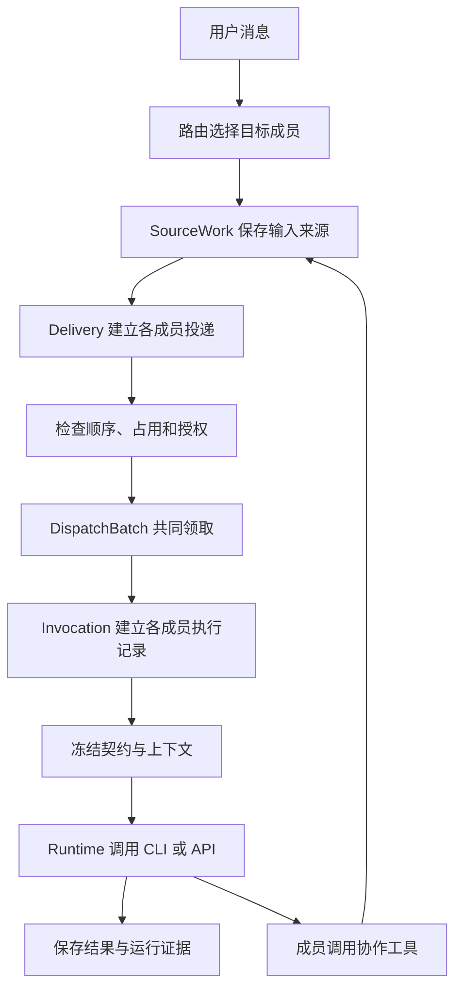
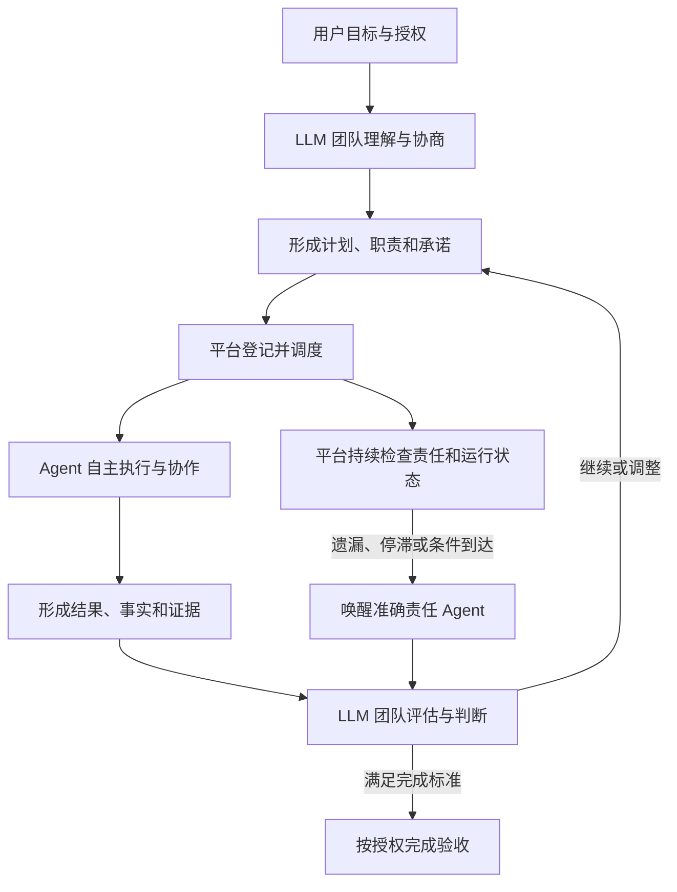
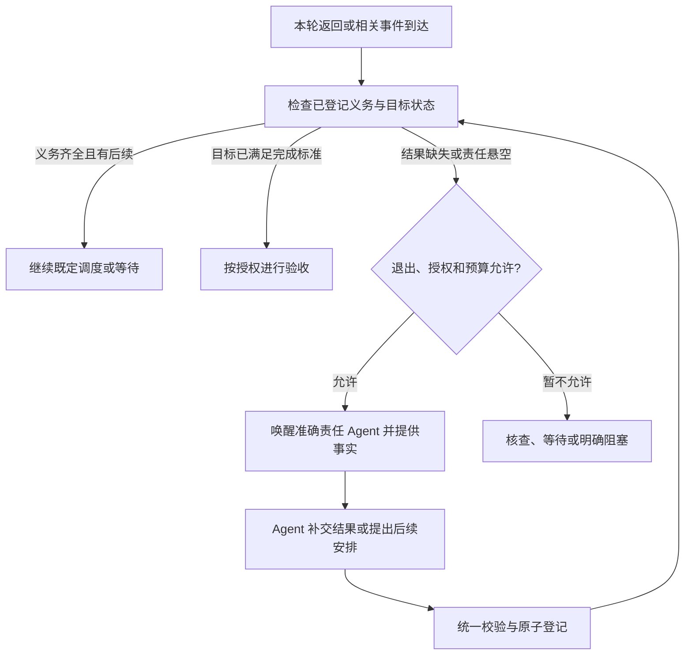

# 多 Agent 协作调度与智能团队架构讨论纪要

讨论日期：2026 年 11 月 10 日，Asia/Shanghai。  
项目：Multi Agent Collab。源码基线：`fe1486e3eb85164f3d5be89bb34345ac1ea3409b`，产品版本 `0.25.0`，服务标识 `0.25.0-p8-pr-ci`。  
文档性质：源码调研与架构讨论归档。架构方向与用户明确原则已记录；数据模型、接口、具体策略及开发范围仍需细化。本次归档不将讨论稿升级为正式实施指导。

今天的讨论从现有项目的消息路由和调度源码出发，发现了“执行结束但责任没有继续传递”的缺口；随后通过研发评审和狼人杀两个场景，逐步明确了通用平台与任务规则的边界。最终方向是：**LLM 团队承担认知、判断和决策，平台提供目标、任务、责任传导与可靠调度的基础能力。**

用户明确提出的三项架构约束是：

> 1、所有场景共用交付、等待、校验、补交和恢复机制；  
> 2、这套调度平台应该适配所有的任务类型；  
> 3、调度核心无需增加针对某个场景的特殊分支。

用户进一步明确平台愿景：

> 需要充分发挥 LLM 作为大脑的能力，平台作为责任、任务、目标传导和调度的媒介，提供完善的基础能力，让多个 Agent 组成的团队变成无限逼近拟人的智能团队。

## 1 当日讨论脉络

| 顺序 | 用户提出的问题或要求 | 本轮形成的认识 |
| --- | --- | --- |
| 1 | 更新代码 | 拉取时 `main` 与远端一致，提交为 `fe1486e`；当时服务健康检查正常。 |
| 2 | 基于源码分析有哪些模块及职责 | 核心由路由、持久状态、执行驱动、上下文、承载适配及各领域服务组成。 |
| 3 | A2A 协作的发起者是谁 | 普通 A2A 由执行中的 Agent 调用工具发起；平台校验身份、保存来源并调度。特定受管退修也会由平台生成 A2A 来源。 |
| 4 | Claude 只写“需要 Codex 修复”，是否保证责任传导 | 普通文字不能保证生成后续修复工作；执行成功与业务问题解决分别记录。 |
| 5 | 是否存在交接协议缺失后的提醒兜底 | 已有正式交接检查和部分责任诊断，缺少通用的“应交付而未交付”检测与自动补交。 |
| 6 | 当前状态机是什么逻辑模式 | 多个领域状态机，通过显式命令、运行证据、事务和周期对账共同推进。 |
| 7 | 给出以问题为导向的图文优化方案 | 初步提出交付契约、结构化结果、有限补交、责任状态及验收机制。 |
| 8 | 是否能让 Agent 自主玩狼人杀，用户只旁观 | 当前具备部分多人协作原语，但缺少可靠的持续推进、角色视角和规则执行组合。 |
| 9 | 反对引入专用游戏平台控制器 | 专用场景控制器的建议被否定；应当以通用协作能力承载不同任务实例。 |
| 10 | 明确三项泛化约束 | 共用基础机制、任务类型不受核心限制、核心不增加场景分支。 |
| 11 | 强调 LLM 为大脑，平台为媒介 | 协议应承载团队动态形成的约定；业务决策交给 Agent，平台负责事实、权限、责任和执行连续性。 |
| 12 | 将今天讨论内容落盘 | 保存本纪要及可离线阅读的图文版，作为后续设计依据。 |

## 2 当前源码的模块与调度主链

当前实现可以归纳为单机、会话驱动、按来源持久调度的多 Agent 协作系统。`store.ts` 维护状态和调度规则，`engine.ts` 驱动实际执行，`runtime*.ts` 适配 CLI 或 API。服务还保留独立的 legacy 顺序任务入口。[S01][S02][S03]

| 模块 | 主要文件 | 当前职责 |
| --- | --- | --- |
| 服务与接口 | `server/index.ts`、`collaboration/http.ts` | 装配服务、提供业务命令与查询、通过 SSE 更新工作台。 |
| 共享模型 | `shared/collaboration.ts` | 定义账户、成员、会话、来源、投递、执行、回复及领域协议。 |
| 成员和工作区 | `workbench.ts`、`account-discovery.ts` | 配置成员、账户、模型、附件与工作区授权，解析本轮有效配置。 |
| 路由 | `routing.ts` | 根据显式点名、偏好及有效历史选择目标，与忙闲调度分开。 |
| 持久调度内核 | `store.ts` | 原子领取、执行绑定、输入冻结、终态、A2A、失败回报、取消和恢复。 |
| 连续协作 | `cooperation.ts` | 队列顺序、优先级、撤回、退避、待办归并、活动追加和多人征询。 |
| 执行驱动 | `engine.ts` | 周期扫描和即时推进，调用承载，分发工具调用，处理取消与结果。 |
| 上下文和原生续接 | `context.ts`、`continuity.ts`、`runtime-session.ts` | 组装可见输入，记录摘要，按身份和历史证据决定新建或续接。 |
| 运行时和核查 | `runtime*.ts`、`inspection.ts` | 对接 Codex、Claude Code、Hermes 和两类 API，提供能力与准确执行观察。 |
| 普通任务 | `tasks.ts` | 管理任务、负责人、执行绑定和正式交接。 |
| 产物和交互 | `artifacts.ts`、`interactions.ts` | 产物版本、审批、受管作业、评审及用户问题或权限请求。 |
| 跨会话和专用责任 | `cross.ts`、`actions.ts` | 管理准确端点授权、跨会话消息、Action 候选、退回和条件唤醒。 |
| 可见性和记忆 | `visibility.ts`、`memory.ts`、`history-import.ts` | 私聊、选段、分支、长期记忆、词法检索和既有 CLI 历史导入。 |
| 项目工作 | `project-*` | 项目授权与隔离执行、文件评审、依赖与测试、退修复验、网页、预览、导出及 Git 交付。 |
| 工作台 | `web/CollaborationApp.tsx` 及各面板 | 提供聊天、状态、责任、项目和配置入口；实际调度规则在后端。 |

几个关键对象必须分别理解：[S02]

- `SourceWork`：一份需要处理的输入，可来自用户、A2A、任务或条件唤醒。
- `Delivery`：该输入对某名成员的投递责任。
- `DispatchBatch`：本次共同领取的成员集合，保存串行或并行模式和历史截止点。
- `Invocation`：某名成员的一次准确执行。
- `Response`：该执行的输出，以及它承接的来源集合。
- `Consumption`：关联来源、成员投递和准确回复的承接回执，区分初始输入、工具读取和活动追加。

**投递已承接不代表承载已接受，也不代表任务完成。** 批次创建时就可能记录 Consumption，而 Invocation 仍为 `prepared`，接受状态为 `unknown`。[S03]

## 3 当前状态机的实际模式

当前模式是多个领域状态机协同，状态转换由显式命令和运行证据触发，使用 SQLite 事务保存，再由周期对账推进。[S01][S04]

| 对象或维度 | 当前状态 |
| --- | --- |
| 来源绑定 | `unresolved / bound` |
| Delivery | `pending / held / consumed / withdrawn` |
| Invocation | `prepared / running / succeeded / failed / interrupted / cancel_requested / cancelled` |
| 承载接受 | `unknown / accepted / not_accepted` |
| 执行退出 | `unknown / confirmed` |
| 普通 Task | `todo / doing / blocked / done`，另有冻结、降级和放弃等处置记录 |
| Task Handoff | `waiting / applied / cancelled / refused` |
| Action | `preparing / queued / active / candidate / waiting / returning / replaceable / completed / cancelled / blocked` |
| Action 等待 | `waiting / ready / fired / expired / cancelled` |
| 产物评审 | `pending / submitted / expired / stale / cancelled` |

执行结果、接受和退出相互独立。成员占用的释放要求执行达到终态，并且退出已经确认；单独看到 `succeeded` 不足以证明资源释放。[S05]

正式任务交接先保存 `waiting`，将新投递置为 `held`；核对原责任版本、来源、授权和准确执行退出后，才在事务内切换负责人并释放新投递。[S09]

引擎每 500ms 及相关业务变化后推进工作。它调用任务、Action、产物和协作服务的对账逻辑，扫描可执行来源。业务表保存当前状态，事件表保存审计和订阅所需事件；提交后再通知订阅者。请求 ID 与内容摘要用于命令幂等。[S01][S04]

已有机制较重视准确执行身份、取消保护、资源释放和重复派工防护。通用责任闭环的缺口主要在于：**应当提交结果或安排下一步的 Agent，没有完成这项义务时，平台缺少统一的自动跟进路径。**

## 4 A2A 与责任传导的源码结论

### 4.1 普通 A2A 的发起者

执行中的 Agent 调用 `collaboration_request`，平台通过准确 `invocationId` 绑定发起成员和原执行，创建新的来源及投递。发起身份不由正文声明。一次请求 1–2 个其他成员，默认协作深度上限为 8，另有单执行请求数量和相同内容往返防护。[S07]

普通 A2A 协助不会自动改变普通 Task 的负责人。普通成功不会自动唤回请求者；具备准确调用与消费证明的执行失败，会生成失败回报来源。专用项目退修流程也会由平台根据证据生成 A2A 来源，因此“A2A 总由模型主动调用”只适用于普通请求路径。[S08][S11]

### 4.2 Claude 说需要 Codex 修复的情况

如果 Claude 正常完成评审，在正文中写“发现问题，需要 Codex 修复”，该轮执行通常仍为 `succeeded`。这段文字本身不会生成修复委托，也不会触发仅针对 `failed` 执行的普通 A2A 失败回报。[S08]

普通串行成功回复在满足条件时，可以通过行首 `@成员` 触发文字接力；并行批次会抑制这种接力。专用项目评审和项目修订执行被排除在普通文字接力之外，写了 `@Codex` 也不能据此保证项目退修。[S08]

### 4.3 已有专用退修路径

现有项目退修要求用户原始委托明确启用“有问题继续改”，绑定原作者和评审者，取得受支持检查的失败命令、退出码、版本快照等回执，并核对双方正常退出和授权。平台随后派回原作者；作者在新版本自测通过后，再交原评审者复验。[S11]

只有静态代码审查文字、没有符合条件的失败检查时，不会触发这条退修。已有测试明确覆盖“评审说请继续改，但没有失败测试回执”的不派工行为。当前复验记录 `passed / failed / unverified`，不会无限自动修到通过。[S12]

### 4.4 已有诊断及其边界

| 机制 | 已有行为 | 当前边界 |
| --- | --- | --- |
| Task 正式交接 | 校验版本和退出证据后应用交接 | 需要先有明确交接请求。 |
| Task 责任投影 | 可标记任务未完成却无执行承接的 `attention / void` | 主要提供诊断，没有通用自动补交。 |
| Action 对账 | 活动执行退出但无候选时转为 `replaceable` | 等待明确后续，没有自动要求原成员补交。 |
| 产物评审 | 要求 `review_submit` 提交结论 | 缺失时可能保持待提交，最后到期或失效。 |
| 项目退修 | 在特定失败检查条件下推进 | 尚未覆盖任意审查意见和所有责任节点。 |

以上分别见任务、Action 和产物评审实现。[S09][S10][S13]

## 5 方案演进与已调整的方向

| 讨论阶段 | 当时提出的思路 | 归档时的处理 |
| --- | --- | --- |
| 从研发缺口入手 | 增加交付契约、结构化结果、有限补交、状态机和验收 | 保留为通用基础能力的设计候选。 |
| 用狼人杀检验 | 增加专用游戏控制器管理身份、阶段及结算 | 用户明确反对，不作为最终架构方向。 |
| 收敛通用运行时 | 将角色、状态、义务、收集和转换表达为任务协议 | 保留，但需避免要求所有任务预先定义完整流程。 |
| 明确 LLM 为大脑 | 让团队动态规划、协商、判断和调整，平台承载决定 | 作为最终顶层定位。 |

专用游戏控制器的提议曾用于解释当时缺少的能力，用户随后指出其违背平台泛化原则。后续设计不得把这个历史提议误写成已确认需求，也不得以同样方式为每类任务增加专用闭环控制器。

## 6 用户明确的架构原则与平台定位

三项硬约束保持原义：所有场景共用交付、等待、校验、补交和恢复机制；平台适配所有任务类型；调度核心不增加针对特定场景的特殊分支。

“适配所有任务类型”的工程含义是，任务类型不受调度内核限制。具体知识、判断、规则和工具能力由 Agent、任务约定及授权能力提供。能力暂不可用时，实例保留责任并明确等待或受阻，不能虚构完成。

平台应承担 LLM 团队的组织与执行基础设施。LLM 负责理解、推理、协商和决策；平台让目标、承诺和决定准确传递、持续可追踪，并在中断后接续。

| 工作 | LLM 团队负责 | 平台负责 |
| --- | --- | --- |
| 目标 | 理解意图、识别歧义、提出完成依据 | 保存原始目标、约束、授权及有效变更。 |
| 计划 | 分解、选择方法、调整优先级 | 保存版本、关联和依赖。 |
| 组织 | 分工、征询、协商、委托专家和重新安排 | 维护准确身份、责任及权限。 |
| 结果 | 评审、质疑、验证和决定是否继续 | 提供版本、事实、来源与执行证据。 |
| 异常 | 判断换方法、重试、换成员或受阻 | 发现遗漏、中断和超时，恢复准确现场。 |
| 完成 | 获授权成员或条件确认目标满足 | 核对验收权限、结果绑定和必要退出证据。 |

团队可以形成临时负责人、执行者、评审者和专家；不要求所有会话永久存在一个固定协调者。平台不能通过普通文字改写权威事实和授权。

## 7 通用协作模型的设计候选

以下是下一步细化所需的概念，不等于已经确定数据库结构或工具名称。

### 7.1 目标 工作与责任承诺

| 对象 | 表达内容 | 防止的问题 |
| --- | --- | --- |
| 目标 | 为什么做、要达到什么、受哪些约束 | 执行很多动作却偏离用户意图。 |
| 工作 | 当前做什么、依赖什么、产生什么结果 | 计划无法拆分、汇合或动态调整。 |
| 责任承诺 | 谁需要交付、跟进或作出判断 | 一段回复结束后责任消失。 |

一个目标可以关联多个工作项。普通协助、阶段执行和正式负责人变更分别记录；评审通常不需要反复切换 Task 的负责人。协商和承诺是组织行为，不给每次已有正式交接强加额外“接单确认”。

### 7.2 六类通用基础能力

| 能力 | 统一职责 | 现有基础及扩展方向 |
| --- | --- | --- |
| 协作实例 | 目标、当前约定、状态、预算、结束条件及事件历史 | 关联现有会话、Task 或 Action，具体关联模型待定。 |
| 受控信息空间 | 按成员、分组和观察者权限提供材料 | 扩展 visibility，支持公共与本人私有信息组合。 |
| 交付义务 | 谁需要在何种条件下提交什么 | 引用准确 Invocation、来源和版本，复用投递。 |
| 收集与等待 | 等待全部、指定数量、首个有效结果或事件 | 复用条件等待，补充持久收集和汇合规则。 |
| 校验与提交 | 检查身份、版本、权限及结果条件，原子更新 | 复用事务、幂等和运行证据。 |
| 续跑与恢复 | 唤醒、补交、有限恢复、取消和超限处理 | 接入 engine 对账循环，防止工作静默停住。 |

### 7.3 协议承载团队约定

协议可以从首轮 Agent 对任务的理解逐步形成，在授权内增加子工作、参与者、等待条件和后续安排。允许串行、并行、循环、分支和动态组织，不要求所有任务先画成固定 DAG。

协议变更需要保存版本和原因，核对提出者权限，保护已开始执行的冻结输入。改变用户原目标或扩大授权，必须遵守原授权边界。

自然交流保持丰富语义。具体委托、等待、交付、验收和责任变化通过轻量操作登记；不要求每条消息都成为固定 JSON 表单。

### 7.4 三种校验责任

- 结构校验：提交格式、成员身份、版本、目标、重复及必要字段。
- 可执行约束：获准次数、状态转换、收集条件和已表达的机械规则。
- 语义判断：评审是否充分、问题是否成立、下一步是否合理，由获授权的 Agent 判断并记录依据。

结构合法不代表结论正确。复杂语义可以通过独立评审、异议和复验加强；多名 Agent 一致表态也需要保留证据来源。

## 8 目标看护与责任补交

建议建立一个通用的不变量：

> 每个尚未结束的受管协作实例，都必须具有可执行的工作、明确的等待条件，或可解释的阻塞状态。

如果目标未结束，但已经没有活动工作、等待条件或明确阻塞，平台应识别责任悬空，提供当前事实并唤醒准确责任 Agent，由其决定继续执行、补充验证、调整分工、登记等待或明确结束。

这项“目标看护”只负责发现过程缺口和恢复思考入口。平台不依据一段普通自然语言擅自编造业务下一步。

补交结果和重新执行业务工作分别管理。补交只要求补齐既有结论、证据或安排；重新修改项目、重跑检查等工作应有相应授权和独立预算。补交次数、业务修复轮数、超时和成本上限的具体默认值仍待确认，讨论中出现的“一次补交、一轮修复”仅是早期建议。

原执行正常返回可以保持 `succeeded`，交付义务仍可处于未履行状态。补交通过新的准确执行承接，不覆盖原始结果。旧执行退出未知时，先核查或等待，不能以补交绕开占用保护。

结果登记与后续派发需要一致性：满足释放条件时在事务内保存结果和唯一后续来源；尚未满足时保存待释放状态，再幂等推进。每个阶段、代次和有效提交要能关联唯一的后续工作，避免两个机制重复续跑。

取消、撤权、成员不可用、材料过期或超限时，责任不消失。平台应明确展示当前责任人、缺失项、阻塞原因及可用处理方式。

## 9 拟人团队需要的基础能力

1. **动态组织。** 成员在授权池内选择协作者，形成临时职责并根据新情况重新安排。
2. **承诺连续。** 自然交流中的关键工作安排可被准确登记，任务完成与责任变更有来源和证据。
3. **正式等待。** Agent 登记等什么、由谁继续、何时超时，平台持久监听，避免持续轮询和空转。
4. **主动跟进。** 平台发现停滞并恢复责任成员的思考机会，Agent 判断下一步。
5. **有边界的共同记忆。** 公共、个人和分组信息分别可控；事实、假设、判断和承诺保持区分。
6. **异议与自检。** 成员可以质疑结论、提供反证、请求独立评审，意见不同不被简单抹平。
7. **组织经验积累。** 复盘建议形成有来源、有版本、生效范围明确的知识或团队约定，可追溯与撤回；不据此宣称模型权重已经更新。
8. **自主范围清晰。** 在用户授权及预算内自主解决问题，超出范围时明确处理；验收权可授予角色或规则，不强制所有任务由用户逐轮确认。

“无限逼近拟人智能团队”作为演进方向，通过可观察能力逐步检验：自主分工、有效协商、主动跟进、持续记忆、独立验证以及对交付结果负责。

## 10 两个场景对同一内核的检验

### 10.1 研发评审

用户委托 Codex 修复并请 Claude 评审。Codex 实施并请求评审；Claude 发现问题但未登记处理安排。平台识别评审义务未履行，唤醒 Claude，附原委托、版本和已有意见。Claude 判断后提交修订请求；平台核对原作者、授权、退出和预算后派发。

Codex 可以修复、提出异议、补充证据或寻求第三方意见，并登记相应等待。直到获授权验收者确认目标满足，或团队明确说明受阻原因，平台持续维护责任与下一步。

无失败测试的静态代码问题也可成为有证据的修订理由，不能强行包装为测试失败。新版本必须有对应评审，旧版本通过结论不能批准新内容。

### 10.2 用户只旁观的狼人杀

当前源码支持多个成员及部分公开私聊隔离，但缺少将长期自动推进、秘密信息、行动收集和结算可靠组合起来的能力。普通成功不回唤，征询只汇总，深度限制也不适合作为整局持续运行机制。[S07][S14]

秘密身份不能简单放入成员职责：同伴目录会包含职责片段。现有公开执行过滤未公开私聊，私聊又禁止若干跨范围协作工具，因此不能直接等同于“玩家持有私有身份并参与公开回合”的通用信息投影。[S06][S15]

最终方向以通用原语表达：

| 狼人杀表达 | 通用协作表达 |
| --- | --- |
| 玩家、主持、观众 | 临时角色与权限。 |
| 身份、存活状态、轮次 | 按主体授权的状态与材料。 |
| 发言、投票、行动 | 带格式、期限和次数约束的交付义务。 |
| 收齐行动 | 持久收集条件。 |
| 阶段变化与结算 | 任务协议中的条件转换和获授权判断。 |
| 主持忘记继续 | 目标未结束且无后续工作的通用看护。 |
| 玩家漏答 | 通用补交与协议约定的超时处理。 |
| 游戏结束 | 实例完成条件。 |

游戏知识与规则仍需在任务约定、角色职责或可执行约束中表达。调度核心不增加职业、昼夜、投票或胜负等专用分支。观众权限与玩家信息输入分别控制；用户开局后无需充当每轮催办者或裁决者。

该场景的验收应检查自主推进到结果，或在不可恢复异常下明确暂停并保存记录。不能把“角色扮演对话能够继续”直接视为规则和隐私已经得到保障。

## 11 后续细化与落地建议

以下为设计候选，不是已启动阶段，也未改变当前产品实施进度。

| 建议步骤 | 范围 | 达成条件 |
| --- | --- | --- |
| 明确通用对象和语义 | 目标、工作、责任、结果、等待、验收及自主授权 | 两个差异场景可用相同模型表达。 |
| 补齐基础执行机制 | 契约、结果登记、持久收集、条件续跑、补交和悬空检查 | 跨场景复用同一状态转换和恢复路径。 |
| 验证连续性与控制边界 | 取消、撤权、版本变化、重复提交、重启和执行未知 | 不丢责任、不重复执行、不绕过授权。 |
| 验证动态团队 | 临时角色、异议、重新分工、记忆与主动跟进 | Agent 可自主调整，核心无需场景判断。 |

代码层面可优先复用 `store.ts` 的事务和幂等、`engine.ts` 的对账、现有投递与执行模型，以及 Task/Action 的责任绑定。是否新增独立责任服务、如何关联没有 Task 的普通委托、工具是否统一入口等，需先细化。

新能力应按新签发策略启用。历史冻结契约保留原语义，不能凭新规则补造旧责任证据。已有项目退修与未来通用推进之间，需要唯一的推进责任，防止同时创建后续工作。

确认后的规则再汇入代码仓正式指导；实现和适用独立验收分别记录。草案、图示和原始验收证据继续放在本地资料库，不加入 `docs/`。

## 12 验收矩阵与观察指标

| 验收场景 | 预期行为 |
| --- | --- |
| Agent 只写自然语言，遗漏已承诺交付 | 缺失可检测，按策略唤醒原责任成员补交或判断。 |
| 目标未完成且无人继续 | 识别责任悬空，提供事实并恢复责任成员的决策入口。 |
| 同一结果重复提交 | 结果与后续来源均幂等，不重复派工。 |
| 多个结果并行到达 | 按准确参与集合、版本和收集条件汇合。 |
| 执行返回但退出未知 | 保持核查或等待，不启动冲突执行。 |
| 在登记、释放和派发边界重启 | 从持久状态恢复，不丢责任，不重复执行。 |
| 用户取消或撤权 | 停止对应后续推进，迟到结果只保留审计。 |
| 已评审材料发生变化 | 旧结论保留历史，当前版本重新核对。 |
| 结果有分歧 | 保留意见与依据，由获授权成员决定验证或后续安排。 |
| 成员不可用、超时或预算耗尽 | 使用已约定处理策略，或进入明确阻塞。 |
| 用户仅旁观 | 在初始授权内自行推进，完成权不被固定绑定为用户逐轮确认。 |
| 接入新的任务类型 | 主要改变任务约定、职责和能力，调度核心不出现新的场景分支。 |

持续观察的指标可以包括：用户干预次数、责任悬空率、重复执行率、无效往返、独立验证后的有效完成率、恢复成功率、调用成本与时长，以及新增任务是否要求修改核心。具体采样口径、阈值和默认预算仍待定义。

平台可验证的基本承诺是，每项已登记工作具有准确责任、状态和下一步或明确阻塞。任务最终成功、复杂判断正确和团队能力提升，需要相应证据与独立验证。

## 13 待进一步讨论的问题

1. 目标、工作和责任承诺如何关联当前 Task/Action，如何处理没有显式 Task 的协作？
2. 从自然交流形成可执行承诺时，采用成员主动工具、获授权的跟进 Agent，还是两者组合？
3. 哪些节点必须有交付约定，如何让约定足够轻量，避免表单化？
4. 团队如何选择临时组织者、验收者和后继责任人，如何处理协商失败？
5. 目标看护何时触发，如何避免昂贵空转、重复唤醒或错误打断？
6. 补交、重试、重新评审、重新执行和业务修复如何分别计数及授权？
7. 多人并行工作何时汇合，如何处理部分失败、否决、意见冲突和取消？
8. 如何组合公共、个人、分组和观察者视图，保证原生续接与信息边界一致？
9. Agent 提出的协议变更何时生效，怎样保护在途执行和旧证据？
10. 自动完成与人工验收如何按任务授权，如何解释“完成但未验证”或“明确受阻”？
11. 团队记忆和复盘建议如何验证、版本化和撤回，如何避免把推测变成事实？
12. 如何通过跨场景验收证明复用同一机制，并持续防止专用逻辑侵入调度核心？

## 14 源码定位与阅读顺序

建议阅读顺序：共享模型 → 路由 → `store.ts` 的发送、准入、A2A、终态 → 引擎 → 连续协作 → 任务、Action 和可见性 → 项目退修及对应测试。

以下链接固定到本次源码基线；本地代码目录为 `D:\project\Multi-agent`。源码结论对应此提交，后续版本变化应重新核对。

| 引用 | 文件与位置 | 支持内容 |
| --- | --- | --- |
| [S01][S01] | `server/collaboration/engine.ts:26` | 启动、500ms 扫描、对账和执行驱动。 |
| [S02][S02] | `shared/collaboration.ts:135` | 投递、批次、执行、回复和消费模型。 |
| [S03][S03] | `server/collaboration/store.ts:521` | 来源准入、批次及准确承接关系。 |
| [S04][S04] | `server/collaboration/store.ts:259` | 事务、事件和持久状态。命令幂等位于 318 行附近。 |
| [S05][S05] | `server/collaboration/store.ts:501` | 执行终态与退出证据共同决定占用。 |
| [S06][S06] | `server/collaboration/context.ts:70` | 同伴职责目录与冻结输入。 |
| [S07][S07] | `server/collaboration/store.ts:695` | 普通 A2A 身份、深度、数量及防往返。 |
| [S08][S08] | `server/collaboration/store.ts:738` | 终态、失败回报、文字接力及排除条件。 |
| [S09][S09] | `server/collaboration/tasks.ts:190` | 正式交接。责任诊断位于 249 行附近。 |
| [S10][S10] | `server/collaboration/actions.ts:152` | 执行退出无候选时等待后续，以及条件唤醒。 |
| [S11][S11] | `server/collaboration/project-revisions.ts:94` | 失败检查退修、作者自测、原评审复验及结论。 |
| [S12][S12] | `tests/collaboration-project-review.test.ts:367` | 无失败回执不退修、复验限次等测试。 |
| [S13][S13] | `server/collaboration/artifacts.ts:199` | 固定版本评审及结构化结论；到期扫描在 117 行附近。 |
| [S14][S14] | `server/collaboration/cooperation.ts:144` | 多人征询收集、只汇总不自动回唤及恢复边界。 |
| [S15][S15] | `server/collaboration/visibility.ts:45` | 公开与私聊历史过滤、工具边界。 |
| [S16][S16] | `tests/collaboration-kernel.test.ts:24` | 幂等、成组等待、重叠顺序和独立成员绕行。 |
| [S17][S17] | `tests/collaboration-cooperation.test.ts:32` | 排序、归并、追加、多方结果及异常恢复场景。 |
| [S18][S18] | `server/collaboration/routing.ts:42` | 确定性目标路由。 |

本纪要中的实现结论来自源码及测试内容核对，未把历史独立验收记录当作本机新验收。今天未因本次调研或归档重新调用真实模型验证上述业务能力。

[S01]: https://github.com/cat15926/Multi-Agent-collab/blob/fe1486e3eb85164f3d5be89bb34345ac1ea3409b/server/collaboration/engine.ts#L26
[S02]: https://github.com/cat15926/Multi-Agent-collab/blob/fe1486e3eb85164f3d5be89bb34345ac1ea3409b/shared/collaboration.ts#L135
[S03]: https://github.com/cat15926/Multi-Agent-collab/blob/fe1486e3eb85164f3d5be89bb34345ac1ea3409b/server/collaboration/store.ts#L521
[S04]: https://github.com/cat15926/Multi-Agent-collab/blob/fe1486e3eb85164f3d5be89bb34345ac1ea3409b/server/collaboration/store.ts#L259
[S05]: https://github.com/cat15926/Multi-Agent-collab/blob/fe1486e3eb85164f3d5be89bb34345ac1ea3409b/server/collaboration/store.ts#L501
[S06]: https://github.com/cat15926/Multi-Agent-collab/blob/fe1486e3eb85164f3d5be89bb34345ac1ea3409b/server/collaboration/context.ts#L70
[S07]: https://github.com/cat15926/Multi-Agent-collab/blob/fe1486e3eb85164f3d5be89bb34345ac1ea3409b/server/collaboration/store.ts#L695
[S08]: https://github.com/cat15926/Multi-Agent-collab/blob/fe1486e3eb85164f3d5be89bb34345ac1ea3409b/server/collaboration/store.ts#L738
[S09]: https://github.com/cat15926/Multi-Agent-collab/blob/fe1486e3eb85164f3d5be89bb34345ac1ea3409b/server/collaboration/tasks.ts#L190
[S10]: https://github.com/cat15926/Multi-Agent-collab/blob/fe1486e3eb85164f3d5be89bb34345ac1ea3409b/server/collaboration/actions.ts#L152
[S11]: https://github.com/cat15926/Multi-Agent-collab/blob/fe1486e3eb85164f3d5be89bb34345ac1ea3409b/server/collaboration/project-revisions.ts#L94
[S12]: https://github.com/cat15926/Multi-Agent-collab/blob/fe1486e3eb85164f3d5be89bb34345ac1ea3409b/tests/collaboration-project-review.test.ts#L367
[S13]: https://github.com/cat15926/Multi-Agent-collab/blob/fe1486e3eb85164f3d5be89bb34345ac1ea3409b/server/collaboration/artifacts.ts#L199
[S14]: https://github.com/cat15926/Multi-Agent-collab/blob/fe1486e3eb85164f3d5be89bb34345ac1ea3409b/server/collaboration/cooperation.ts#L144
[S15]: https://github.com/cat15926/Multi-Agent-collab/blob/fe1486e3eb85164f3d5be89bb34345ac1ea3409b/server/collaboration/visibility.ts#L45
[S16]: https://github.com/cat15926/Multi-Agent-collab/blob/fe1486e3eb85164f3d5be89bb34345ac1ea3409b/tests/collaboration-kernel.test.ts#L24
[S17]: https://github.com/cat15926/Multi-Agent-collab/blob/fe1486e3eb85164f3d5be89bb34345ac1ea3409b/tests/collaboration-cooperation.test.ts#L32
[S18]: https://github.com/cat15926/Multi-Agent-collab/blob/fe1486e3eb85164f3d5be89bb34345ac1ea3409b/server/collaboration/routing.ts#L42
